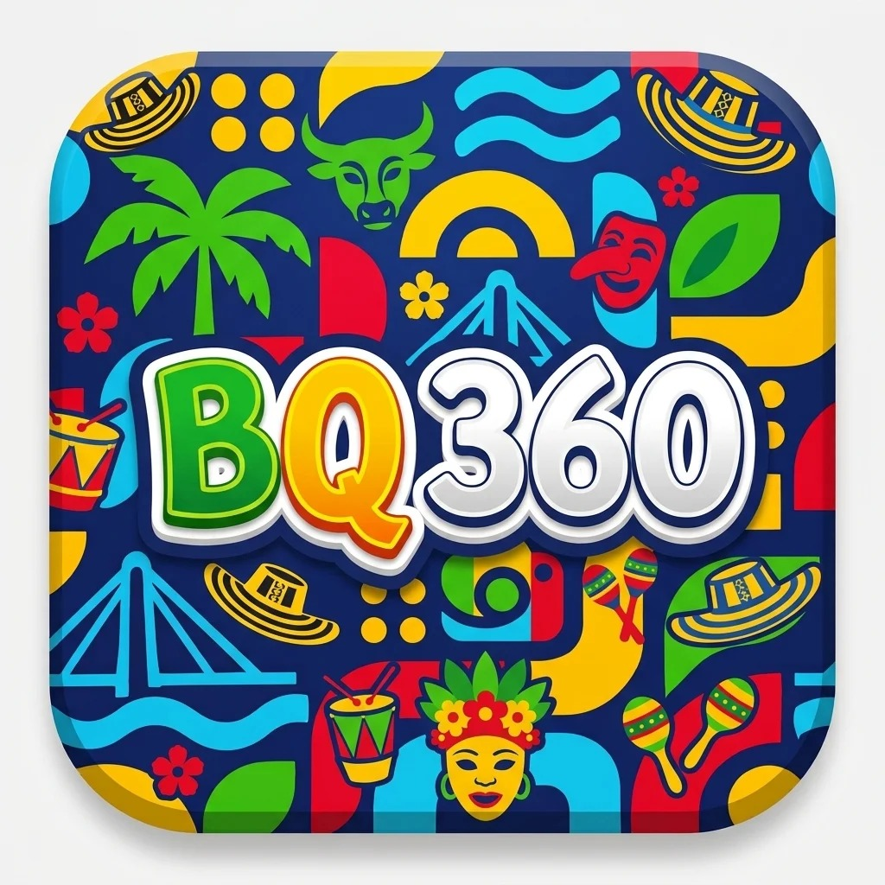

# BQ360 — Barranquilla 2034 (QUIJAM 2026)

  

**BQ360** es un programa estratégico de inteligencia territorial para Barranquilla 2034 que combina gobernanza urbana con un mapa 3D Ciudad-Estadio de balanceo dinámico por aforo, acceso inclusivo *offline-first* y tótems físicos con QR/Wi-Fi, validado en el corredor piloto **Estadio Metropolitano ↔ Transmetro y comercios barriales ↔ Gran Malecón / Ciénaga de Mallorquín**, y diseñado para permanecer como gemelo digital ciudadano tras el evento.

## Documentación (`docs/`)

* [Programa integral y requisitos QUIJAM (`BQ360_Barranquilla_2034.md`)](./docs/BQ360_Barranquilla_2034.md) — Programa BQ360 en 5 dimensiones (`BQ Territory`, `BQ Green`, `BQ Intelligence`, `BQ Community`, `BQ Economy`), `BQ Nodes`, hoja de ruta 2026–2035+, sprints oficiales y entregables Demo Day.
* [Dossier de investigación Sprint 1 (`BQ360_Sprint1_Dossier.md`)](./docs/BQ360_Sprint1_Dossier.md) — Diagnóstico con cifras oficiales verificadas, cinco dimensiones, arquitectura inicial, datos disponibles vs. simulados y plan de validación en campo.
* [Cierre Sprint 1 (`Sprint 1 - BQ360.md`)](./docs/Sprint%201%20-%20BQ360.md) — Estructura de 6 bloques para el entregable/póster y checklist operativo del Sprint 1.
* [Documento maestro (`BQ360.md`)](./docs/BQ360.md) — Contexto territorial, rúbrica QUIJAM, visión de módulos, caso demostrativo y registro de decisiones.
* [Propuesta base (`Propuesta Barranquilla 2034 - BQ360.md`)](./docs/Propuesta%20Barranquilla%202034%20-%20BQ360.md) — Identificación del problema, población multi-actor, objetivos, solución 3D, propuesta de valor y pitch.
* [Notas iniciales (`Barranquilla 2034 sede mundial..md`)](./docs/Barranquilla%202034%20sede%20mundial..md) — Lluvia de ideas original del equipo.
