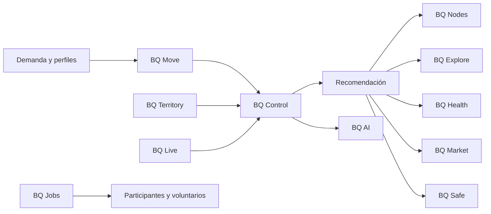

# BQ360 — Catálogo de módulos para Barranquilla

> Documento operativo de módulos. Todos los datos, rutas, capacidades y estados son simulados y deben identificarse como demostración.

## Propósito

BQ360 integra movilidad, territorio, participación, seguridad, economía y asistencia en un solo flujo urbano para Barranquilla. Los módulos no funcionan como aplicaciones aisladas: comparten escenarios, recursos, recomendaciones, incidencias, avisos y el estado operativo del simulador.

## Descripción breve de todos los módulos

| Módulo | Función breve |
|---|---|
| BQ Move | Distribuye personas entre rutas compatibles según la demanda, la accesibilidad y la capacidad. |
| BQ Explore | Recomienda cultura, turismo y destinos barranquilleros según el recorrido disponible. |
| BQ Safe | Entrega alertas, líneas de emergencia y orientación ante calor, arroyos y cierres. |
| BQ Market | Gestiona comercios barriales, cupos, vigencias y derivaciones comerciales. |
| BQ Green | Vincula movilidad y recomendaciones con clima, reciclaje y puntos verdes. |
| BQ Health | Orienta hacia hidratación, atención y prevención climática. |
| BQ Jobs | Presenta oportunidades demostrativas de empleo, formación y voluntariado. |
| BQ Live | Recibe reportes ciudadanos y activa revisión humana y pausas preventivas. |
| BQ Control | Integra escenarios, políticas, mapas, incidencias, métricas e historial. |
| BQ AI | Explica asignaciones y pausas usando únicamente el estado verificable del simulador. |
| BQ Territory | Representa Barranquilla con mapa vectorial offline, cargas, servicios y cuellos de botella. |
| BQ Nodes | Lleva avisos impresos y digitales a puntos físicos con control de vigencia y retirada. |

## Alcance detallado

## Flujo principal

## Módulos funcionales

### BQ Move

**Propósito:** distribuir demanda entre rutas compatibles y representar la carga de movilidad.

**Alcance mínimo:**

- Ruta más corta, balanceo y intervención urbana.
- Perfiles `flex`, `access` y `press`.
- Reservas para perfiles con menos alternativas.
- Cruces compartidos descontados una sola vez.
- Rutas para el Estadio Metropolitano, Av. Murillo, Circunvalar, Calle 30, El Prado y el Gran Malecón.
- Conservación de personas ya en tránsito al cambiar una condición.

**Estado:** activo en motor determinista.

### BQ Explore

**Propósito:** orientar a visitantes y residentes hacia cultura, turismo y lugares de interés.

**Servicios de Barranquilla:**

- Gran Malecón.
- Ciénaga de Mallorquín.
- Centro Histórico.
- El Prado.
- Estadio Metropolitano.
- Punto Verde.
- Mercados y comercios barriales.

**Relación:** consume rutas y servicios disponibles emitidos por BQ Move y BQ Control.

### BQ Safe

**Propósito:** comunicar riesgos y orientar ante emergencias con líneas y protocolos reales de Colombia.

**Contenido mínimo:**

- `123` Policía o emergencias.
- `125` Salud o CRUE.
- `119` Bomberos.
- Alertas de calor, arroyos y cierres.
- Diferencia visible entre pausa preventiva y cierre oficial verificado.
- Puntos de hidratación y atención.

**Restricción:** no reemplaza alertas oficiales ni atención profesional.

### BQ Market

**Propósito:** representar el comercio barrial y derivar demanda compatible sin imponer consumo.

**Alcance mínimo:**

- Comercios de los corredores piloto.
- Cupo y vigencia.
- Apertura, cierre y reapertura de recepción.
- Invalidación únicamente de opciones comerciales afectadas.
- Recálculo de recomendaciones.
- Rotación comercial solo entre alternativas equivalentes.

### BQ Green

**Propósito:** conectar movilidad y recomendaciones con sostenibilidad climática.

**Alcance mínimo:**

- Calor extremo.
- Arroyos y lluvia.
- Ciénaga de Mallorquín y puntos verdes.
- Residuos y reciclaje.
- Transporte sostenible.
- Restricciones ambientales que pueden afectar una ruta.

### BQ Health

**Propósito:** orientar a hidratación, descanso y atención preventiva.

**Alcance mínimo:**

- Puntos de hidratación.
- Puestos de atención.
- Accesibilidad para movilidad reducida.
- Alertas climáticas.
- Separación clara entre orientación general y atención médica.

### BQ Jobs

**Propósito:** mostrar oportunidades demostrativas de empleo, formación y voluntariado.

**Regla:** todo catálogo debe estar rotulado como ilustrativo. Los cupos no representan vacantes reales ni compromisos laborales.

### BQ Live

**Propósito:** recibir y deduplicar reportes ciudadanos para activar revisión humana y pausas preventivas.

**Tipos de reporte:**

- Arroyo.
- Aglomeración.
- Cierre vial.
- Barrera de accesibilidad.
- Calor extremo.

**Estados:**

- `recibido`
- `pausa_preventiva`
- `incertidumbre`
- `verificado`
- `descartado`

**Reglas:**

- Usar `commandId` para deduplicar.
- Registrar responsable, hora y motivo.
- Bloquear reaperturas automáticas ante contradicciones.
- Aplicar pausas solo sobre el recurso afectado.

### BQ Control

**Propósito:** actuar como consola principal del Demo Day y integrar todos los módulos.

**Controles:**

- Escenario de salida o llegada al Estadio Metropolitano.
- Política `shortest`, `balanced` o `intervention`.
- Tick, reinicio e historial de eventos.
- Comparación de mapas.
- Ocupación y capacidad.
- Demandas asignadas y pendientes.
- Incidencias y comercios.
- Estado de acuses `BQ Nodes`.
- Etiqueta visible de simulación.

### BQ AI

**Propósito:** explicar una recomendación o una pausa con información verificable del estado local.

**Alcance mínimo:**

- Explicar por qué una ruta fue asignada.
- Explicar por qué una ruta fue pausada.
- Indicar perfiles, capacidad y condición que originaron el resultado.
- Operar sin API key ni dependencia externa.

## BQ Territory

BQ Territory representa el territorio barranquillero como un mapa vectorial 100 % offline.

**Elementos:**

- Estadio Metropolitano Roberto Meléndez.
- Av. Murillo.
- Circunvalar.
- Calle 30.
- El Prado.
- Centro Histórico.
- Gran Malecón.
- Río Magdalena.
- Ciénaga de Mallorquín.

**Comportamiento mínimo:**

- Grosor y color proporcionales a la carga.
- Símbolo de cuello de botella y texto explicativo.
- Lista textual sincronizada.
- Navegación por teclado.
- Recursos seleccionables.
- Mapa opcional de Google Maps embebido solo cuando exista conexión.

## BQ Nodes

Las estaciones físicas y digitales llevan orientación vigente a puntos como el Estadio, el Gran Malecón, El Prado, el Centro Histórico y el aeropuerto.

**Alcance mínimo:**

- Ficha imprimible con código QR.
- Versión monótona `v1`, `v2`, etc.
- Vigencia visible.
- Ruta y servicios asociados.
- Acuse físico separado del voluntario.
- Invalidación digital al cambiar el aviso.
- Estado `Pendiente de retiro físico`.
- Confirmación única con hora y rol.

## Datos compartidos

Los módulos deben compartir estos conceptos:

| Concepto | Uso |
|---|---|
| Scenario | Define demanda, recursos y alternativas. |
| Resource | Modela espacio, paso o servicio. |
| Route | Conecta origen, destino y recursos compartidos. |
| Profile | Diferencia `flex`, `access` y `press`. |
| Policy | Selecciona `shortest`, `balanced` o `intervention`. |
| Incident | Registra reportes y estados de revisión. |
| Notice | Publica vigencia y orientación por perfil. |
| Projection | Estima cargas por tick sin presentarse como predicción real. |

## Caso patrón de Demo Day

Demanda: `500` personas, compuesta por `400 flexibles` y `100 con necesidad de acceso compatible`.

| Política o condición | A | B | C | D | Pendientes |
|---|---:|---:|---:|---:|---:|
| Ruta más corta | 50 | 0 | 0 | 0 | 450 |
| Balanceo | 50 | 250 | 180 | 0 | 20 |
| Pausa preventiva de C | 50 | 250 | 0 | 0 | 200 |
| Intervención con D accesible | 50 | 250 | 0 | 200 | 0 |

Si D no es accesible, las `100` personas de perfil `access` permanecen pendientes. Nunca se les debe asignar una ruta incompatible.

## Integración obligatoria

1. Demanda.
2. Recomendación.
3. Incidencia.
4. Revisión.
5. Recálculo.
6. Publicación.
7. Orientación física.
8. Acuse y legado.

Ningún módulo puede quedar desconectado de esta cadena ni publicar datos reales sin fuentes verificadas.

## Transparencia

La interfaz debe mostrar:

- Datos simulados.
- Vigencia de avisos.
- Motivo de asignación o pausa.
- Capacidad disponible.
- Perfil atendido.
- Cola pendiente.
- Limitaciones de acceso.
- Estado de verificación de incidencias.
