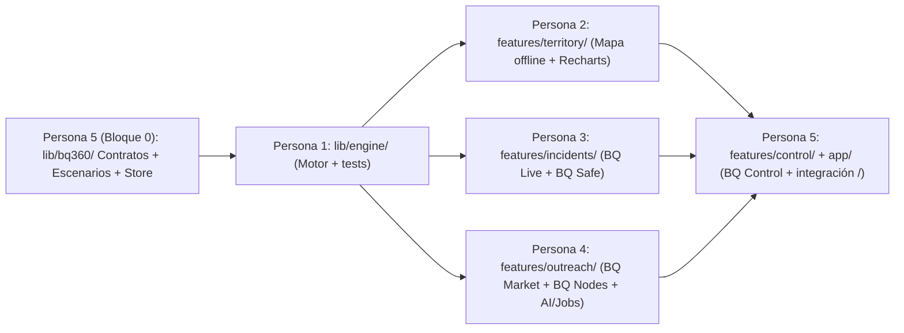

# BQ360 — Plan MVP 100 % Barranquilla (División para 5 personas)

> **Propósito:** Plan operativo ejecutable para construir el MVP de **BQ360** 100 % enfocado en **Barranquilla** sobre la aplicación Next.js ya existente en [`BQ360/`](../BQ360), repartiendo el trabajo en **5 personas sin colisión de archivos** y unificando los requisitos de los tres sprints.

**Documentos base vigentes:**
* [Sprint 1 — Comprender y diseñar](./BQ360-Sprint-1.md) — Diagnóstico, cifras oficiales (`1.334.509` hab., `COP 40,7 B`, `154 km²`) y corredor piloto (*Estadio Metropolitano ↔ Transmetro y comercios barriales ↔ Gran Malecón / Ciénaga de Mallorquín*).
* [Sprint 2 — Diseñar y construir](./BQ360-Sprint-2.md) — Motor determinista, caso patrón de `500` personas, pruebas `P0` y distribución operativa en 5 frentes (Sección 9).
* [Sprint 3 — Validar y consolidar](./BQ360-Sprint-3.md) — App móvil Next.js en `BQ360/`, estado de los 10 módulos, requisitos de consolidación y 5 tareas de validación.
* [Datos de demostración](./BQ360_Datos_Demo.md) — Catálogo ficticio de Barranquilla (perfil, 6 tipos de lugares/rutas, agenda, comunidades y 3 alertas).

---

## 1. Decisiones base del MVP

1. **Un solo proyecto vivo (`BQ360/` en Next.js 15 + React 19 + TypeScript + Tailwind + Recharts):**
   * Todo el MVP corre dentro de `BQ360/` con datos locales TypeScript, sin requerir `FastAPI`, `PostgreSQL/PostGIS`, `Docker` ni `Supabase` durante el Sprint 2/Demo Day.
   * El motor determinista, los comandos, las incidencias, los comercios y los avisos `BQ Nodes` viven en módulos TypeScript puros dentro de `BQ360/lib/`, compartidos mediante un estado reactivo local (`localStorage` + botón de reinicio reproducible), garantizando operación **100 % sin conexión**.
2. **Alcance 100 % Barranquilla en dos escenarios sobre el mismo motor:**
   * **Escenario 1 (`metro-exit-v1` · Salida del Estadio Metropolitano — caso patrón verificable de Sprint 2):** `500` personas (`400` flexibles + `100` con necesidad de acceso compatible) saliendo del Estadio Metropolitano Roberto Meléndez hacia corredores de Barranquilla:
     * `Ruta A` (Av. Murillo directa — cap. `50`),
     * `Cruce compartido B+C` (Nodo Transmetro / Circunvalar — cap. `430`),
     * `Destino B` (Corredor Transmetro Sur y comercios barriales — cap. `250`),
     * `Destino C` (Corredor Accesible El Prado / Gran Malecón — cap. `180`),
     * `Intervención D` (Corredor Independiente Calle 30 / Gran Malecón — cap. `200`, accesible).
   * **Escenario 2 (`metro-entry-v1` · Llegada al Estadio desde toda Barranquilla):** *N* rutas convergentes hacia el Estadio Metropolitano desde **El Prado / Norte**, **Gran Malecón / Ciénaga de Mallorquín**, **Centro Histórico Accesible** y **Aeropuerto Ernesto Cortissoz / Calle 30**, integrando en cada ruta todos los servicios de [BQ360_Datos_Demo.md](./BQ360_Datos_Demo.md):
     * **Hidratación:** `Punto de hidratación BQ`,
     * **Atención / salud:** puestos de atención balanceados,
     * **Comercios barriales:** `Mercado Cultural del Prado` y negocios locales,
     * **Cultura / turismo y ambiente:** `Gran Malecón`, `Centro Histórico Accesible` y `Punto Verde`.
3. **Mapa 100 % offline + conservación de la base móvil existente:**
   * Se conserva la portada móvil de [`BQ360/app/page.tsx`](../BQ360/app/page.tsx) y el **Google Maps embebido** como vista opcional cuando hay internet, pero el mapa operativo de balanceo usa **cartografía vectorial interactiva local (SVG) 100 % offline** para que nunca falle sin red y muestre cargas, cuellos de botella y recálculos reales.
4. **Limpieza total de restos heredados y transparencia de simulación:**
   * Eliminar toda referencia a **Chile** (`133`, `131`, `132`, `+56`, `country default 'Chile'`), **SafeMove** y deportes en inglés (`Cycling`, `MTB`, `Trail Running`) en `BQ360/app/safety/page.tsx`, `BQ360/app/home/page.tsx`, `BQ360/components/sport-selector.tsx` y pantallas de eventos/perfil/auth.
   * Usar líneas reales de Colombia/Barranquilla (`123` Policía/Emergencias, `125` Salud/CRUE, `119` Bomberos) y mostrar en cada pantalla que los datos son simulados.

---

## 2. Reparto para 5 personas (tabla de asignación rápida)

| Persona | Rol / Frente | Responsable asignado | Rama Git | Carpetas exclusivas (solo edita estas) | Entregable visible |
| :--- | :--- | :--- | :--- | :--- | :--- |
| **Persona 1** | **Movilidad y Motor** (`BQ Move`, `Flow Engine`, `Predict`, `Adaptive Routing`) | *(Asignar nombre)* | `sprint2/i1-motor` | `BQ360/lib/engine/` | Motor determinista en TypeScript + pruebas `node --test` pasando todos los casos `P0`. |
| **Persona 2** | **Territorio y Gráficas** (`BQ Digital Twin`, `Explore`, `Green`, `Health`) | *(Asignar nombre)* | `sprint2/i2-territorio` | `BQ360/features/territory/`, `BQ360/app/territory/` | Mapa offline interactivo de Barranquilla, dos mapas sincronizados y gráficas Recharts. |
| **Persona 3** | **Participación y Seguridad** (`BQ Live`, `BQ Safe`) | *(Asignar nombre)* | `sprint2/i3-incidencias` | `BQ360/features/incidents/`, `BQ360/app/incidents/`, `BQ360/app/safety/` | Reporte ciudadano, pausa preventiva, revisión de contradicciones y `/safety` de Barranquilla. |
| **Persona 4** | **Economía, Nodos y Asistencia** (`BQ Market`, `BQ Nodes`, `Jobs`, `AI`) | *(Asignar nombre)* | `sprint2/i4-orientacion` | `BQ360/features/outreach/`, `BQ360/app/outreach/` | Panel de comercios, orientación por perfil, ficha presencial `BQ Node` con acuse físico, `BQ AI` local y `BQ Jobs`. |
| **Persona 5** | **Control, Base Común e Integración** (`BQ Control` + `/` + limpieza) | *(Asignar nombre)* | `sprint2/i5-control` | `BQ360/lib/bq360/`, `BQ360/lib/demo-data.ts`, `BQ360/features/control/`, `BQ360/app/control/`, `BQ360/app/page.tsx`, `BQ360/app/home/` | Bloque 0 de contratos/store, consola `/control`, conexión en portada `/` y cero textos *SafeMove/Chile*. |

> **Regla obligatoria de integración:** Ninguna persona construye pantallas desconectadas del flujo principal: **escenario de demanda → recomendación → incidencia → recálculo → comunicación → legado**.

---

## 3. Arquitectura de carpetas dentro de `BQ360/`



```text
BQ360/
├── lib/
│   ├── demo-data.ts              # Persona 5 · Completado con los 6 lugares y 3 alertas de BQ360_Datos_Demo.md
│   ├── bq360/                    # Persona 5 (Bloque 0) · Base común acordada antes de ramificar
│   │   ├── types.ts              # Contratos v1: Scenario, Resource, Route, Projection, Incident, Notice, Policy
│   │   ├── scenarios.ts          # metro-exit-v1 + metro-entry-v1 + catálogo territorial de Barranquilla
│   │   └── store.tsx             # Estado reactivo compartido, reloj, comandos, historial y reinicio limpio
│   └── engine/                   # Persona 1 · Motor determinista y pruebas
│       ├── routing.ts            # Elegibilidad por perfil, clima, arroyos, barreras y cierres
│       ├── allocation.ts         # Balanceo inclusivo con cruce compartido y rotación comercial
│       ├── simulation.ts         # Reloj multi-intervalo, tránsito no retroactivo y 3 políticas
│       └── engine.test.mjs       # Pruebas automatizadas ejecutables con node --test
├── features/
│   ├── territory/                # Persona 2 · Mapa offline de Barranquilla y gráficas Recharts
│   │   ├── BarranquillaMap.tsx   # Mapa vectorial interactivo 100 % offline con rutas y POIs
│   │   ├── TerritoryComparison.tsx # Dos mapas sincronizados para comparar políticas en el mismo tick
│   │   └── charts/               # Gráficas Recharts (carga vs capacidad, pendientes por perfil, ticks)
│   ├── incidents/                # Persona 3 · BQ Live y BQ Safe
│   │   ├── IncidentReportForm.tsx # Reporte ciudadano con deduplicación (arroyo, calor, cierre, aglomeración)
│   │   ├── OperatorReviewInbox.tsx # Revisión humana, pausa preventiva y bloqueo por contradicciones
│   │   └── SafeAlertsBanner.tsx  # Alertas BQ Safe (pausa preventiva vs cierre verificado)
│   ├── outreach/                 # Persona 4 · BQ Market, BQ Nodes, BQ Jobs y BQ AI
│   │   ├── MerchantPanel.tsx     # Disponibilidad, cupo y cierre de comercios barriales
│   │   ├── PublicNoticeCard.tsx  # Orientación pública por perfil con versión y vigencia
│   │   ├── BqNodeSheet.tsx       # Ficha presencial imprimible/QR + acuse físico independiente
│   │   └── LocalAssistant.tsx    # BQ AI local verificable + catálogo ilustrativo BQ Jobs
│   └── control/                  # Persona 5 · BQ Control e integración
│       ├── ControlDashboard.tsx  # Consola operador: escenario, reloj, políticas, métricas e historial
│       └── ModuleBadgeNav.tsx    # Navegación con estado funcional/simulado/conceptual de los 10 módulos
└── app/
    ├── page.tsx                  # Persona 5 · Portada móvil conectada al flujo vivo
    ├── territory/page.tsx        # Persona 2 · Mapa interactivo de Barranquilla y comparador
    ├── incidents/page.tsx        # Persona 3 · BQ Live (reporte ciudadano y bandeja de revisión)
    ├── safety/page.tsx           # Persona 3 · BQ Safe Barranquilla (reemplaza SafeMove/Chile)
    ├── outreach/page.tsx         # Persona 4 · BQ Market, BQ Nodes, BQ Jobs y BQ AI
    └── control/page.tsx          # Persona 5 · BQ Control (vista principal Demo Day)
```

---

## 4. Detalle de tareas por persona

### Bloque 0 · Arranque común *(Persona 5 con revisión de todos — primeros 25 min)*
Antes de abrir las ramas individuales, **Persona 5** sube a `main`:
* `BQ360/lib/bq360/types.ts`: contratos únicos de escenario, recursos (`space`, `passage`, `service`), rutas, perfiles (`flex`, `access`, `press`), proyecciones, incidentes, avisos `Notice` y políticas (`shortest`, `balanced`, `intervention`).
* `BQ360/lib/bq360/scenarios.ts`: `metro-exit-v1` (caso patrón de Sprint 2) y `metro-entry-v1` (llegada al Estadio desde toda Barranquilla con hidratación, salud, comercios, turismo y Punto Verde).
* `BQ360/lib/bq360/store.tsx`: estado compartido con reloj por ticks, bus de comandos (`report.submit`, `report.review`, `market.update`, `clock.advance`, `intervention.apply`, `node.ack`), versión monótona y botón de reinicio limpio.
* Actualización de `BQ360/lib/demo-data.ts` para incluir todos los lugares y alertas de [BQ360_Datos_Demo.md](./BQ360_Datos_Demo.md).

*(Una vez fusionado el Bloque 0 en `main`, las 5 personas crean su rama desde ese commit y trabajan en paralelo sin bloquearse.)*

### Persona 1 · Movilidad y Motor (`sprint2/i1-motor`)
* Implementar `routing.ts`, `allocation.ts` y `simulation.ts` en `BQ360/lib/engine/`.
* Reglas obligatorias:
  * Descontar el cruce compartido (`cross-BC`) una sola vez entre las rutas que lo comparten.
  * Priorizar perfiles con menos alternativas (`access` reserva plazas compatibles en `C` primero).
  * Aplicar rotación comercial únicamente entre alternativas equivalentes.
  * Conservar estrictamente las cohortes (`recommended`, `inTransit`, `arrived`, `pending`) y **no reasignar retroactivamente** a personas ya en tránsito al cambiar una condición.
* Entregar `BQ360/lib/engine/engine.test.mjs` ejecutable con `node --test` validando:
  * `shortest`: `50` asignados / `450` pendientes.
  * `balanced`: `A=50`, `B=250`, `C=180`, `20` pendientes y `100` `access` atendidos en `C`.
  * Pausa preventiva de `C`: `300` asignados / `200` pendientes (con los `100` `access` en `no_compatible_route`).
  * `intervention` con `D=200` accesible: `500` asignados / `0` pendientes (y al desactivar accesibilidad de `D`, los `100` `access` quedan pendientes).
  * Prueba extra de cruce compartido real (`cruce = 350 < 250 + 180`).
  * Prueba de incidencia con personas ya en tránsito.

### Persona 2 · Territorio, Mapa Offline y Gráficas (`sprint2/i2-territorio`)
* Construir `BarranquillaMap.tsx`: mapa SVG interactivo **100 % offline** de Barranquilla (Estadio Metropolitano, Av. Murillo, Circunvalar, Calle 30, El Prado, Centro Histórico, Gran Malecón, Río Magdalena y Ciénaga de Mallorquín) con:
  * Rutas con grosor y color proporcionales a la carga + símbolo de cuello de botella + motivo en texto.
  * Capas filtrables de **hidratación**, **salud/atención**, **comercios barriales**, **cultura/turismo**, **puntos verdes** y **alertas climáticas/arroyos**.
  * Navegación por teclado y lista textual sincronizada (sin depender solo del color).
* Construir `TerritoryComparison.tsx`: **dos mapas sincronizados** en el mismo tick (`Ruta más corta` vs `Balanceo BQ360` o `Intervención urbana`) con selección compartida de recursos.
* Construir gráficas reutilizables en **Recharts** (`BQ360/features/territory/charts/`): ocupación vs. capacidad por recurso, demanda asignada vs. pendiente por perfil y evolución de colas por tick.

### Persona 3 · Participación y Seguridad (`sprint2/i3-incidencias`)
* Construir `IncidentReportForm.tsx` (`BQ Live`): reporte ciudadano de arroyo, aglomeración, cierre vial, barrera de accesibilidad o calor extremo, con deduplicación (`commandId`) y pausa preventiva acotada sobre el recurso afectado.
* Construir `OperatorReviewInbox.tsx`: bandeja de revisión humana con estados (`recibido`, `pausa_preventiva`, `incertidumbre`, `verificado`, `descartado`), regla que bloquea la reapertura automática si existen reportes contradictorios, y bitácora con rol, hora y motivo.
* Construir `SafeAlertsBanner.tsx` y rehacer `BQ360/app/safety/page.tsx` (`BQ Safe` 100 % Barranquilla): líneas `123`, `125` y `119`, distinción clara entre **pausa preventiva** y **cierre oficial verificado**, alertas de calor/arroyos y puntos de hidratación/salud (eliminando por completo *SafeMove* y *Chile*).

### Persona 4 · Economía, Nodos y Asistencia (`sprint2/i4-orientacion`)
* Construir `MerchantPanel.tsx` (`BQ Market`): lista de comercios barriales del corredor en Barranquilla con cupo, vigencia y botón para cerrar/reabrir recepción (invalida solo las opciones afectadas y dispara recálculo).
* Construir `PublicNoticeCard.tsx`: vista pública accesible por perfil (`Turista`, `Ciudadano`, `Movilidad reducida`, `Prensa`) con ruta asignada, servicios del trayecto, versión del aviso y vigencia.
* Construir `BqNodeSheet.tsx` (`BQ Nodes`): ficha presencial imprimible/QR con versión (`v1`, `v2`...) y **acuse físico separado del voluntario**; cuando el sistema digital invalida un aviso, la ficha queda en `Pendiente de retiro físico` hasta que el voluntario confirme la retirada con hora y rol (sin permitir doble acuse).
* Construir `LocalAssistant.tsx`: asistente local verificable **`BQ AI`** (responde por qué se asignó o pausó una ruta usando el estado del escenario, sin API key) + catálogo demostrativo **`BQ Jobs`** rotulado como ilustrativo.

### Persona 5 · Control, Integración y Limpieza (`sprint2/i5-control`)
* Entregar primero el **Bloque 0** en `main`.
* Construir `ControlDashboard.tsx` (`/control`): consola principal del Demo Day con selector de escenario (`Salida Metropolitano` / `Llegada al Estadio`), selector de política, controles de reloj (`Tick +1`, `Reiniciar`), mapas sincronizados (Persona 2), gráficas Recharts (Persona 2), bandeja de incidencias (Persona 3), estado de comercios y acuses `BQ Node` (Persona 4), historial de eventos y etiqueta visible de simulación.
* Conectar [`BQ360/app/page.tsx`](../BQ360/app/page.tsx) (conservando el diseño móvil de Barranquilla): enlazar las tarjetas (`Move`, `Explore`, `Safe`, `Market`), el botón central `+` hacia reporte `BQ Live`, accesos a `/control`, `/territory`, `/incidents` y `/outreach`, y conmutador de mapa offline / Google Maps embebido.
* Limpiar restos de *SafeMove / Chile / deportes en inglés* en `BQ360/app/home/page.tsx`, `BQ360/components/sport-selector.tsx`, `BQ360/app/events/`, `BQ360/app/profile/` y `BQ360/app/auth/`.

---

## 5. Cronograma táctico (5 h construcción + 4 h revisión)

| Fase | Ventana | Qué entrega el equipo |
| :--- | :--- | :--- |
| **1. Base + Motor** | `0:00 – 1:15` | Persona 5 sube Bloque 0 a `main` (`0:25`); las 5 personas abren su rama; Persona 1 deja el motor con `node --test` en verde. |
| **2. Desarrollo en paralelo** | `1:15 – 3:45` | Personas 2, 3, 4 y 5 construyen sus pantallas aisladas usando el store común y los resultados del motor. |
| **3. Integración y limpieza** | `3:45 – 5:00` | Merge ordenado (`I1 → I2/I3/I4 → I5`), conexión en `/`, limpieza total de *SafeMove/Chile* y `npm run build` en verde. |
| **4. Revisión, pruebas y Demo Day** | `+4 h` | Ejecutar las 5 tareas de validación externa de [BQ360-Sprint-3.md](./BQ360-Sprint-3.md), probar secuencia de 4 min sin internet, grabar video (máx. 5 min) y cerrar presentación. |

---

## 6. Comandos de arranque y verificación local

```powershell
cd BQ360
npm install --legacy-peer-deps
npm run dev
```

Pruebas y verificación antes de hacer PR a `main`:

```powershell
# 1. Pruebas del motor determinista (Persona 1 / Integración)
node --test BQ360/lib/engine/engine.test.mjs

# 2. Compilación de producción Next.js
cd BQ360
npm run build
```

---

## 7. Fuera de alcance explícito (No-Goals del MVP)

* Sin backend `FastAPI`, sin `PostgreSQL + PostGIS`, sin `Docker` y sin `OR-Tools` en ejecución.
* Sin mapa 3D arquitectónico del estadio ni dependencia de Google Maps JavaScript API o `OpenAI API` con claves de pago.
* Sin login obligatorio en Supabase (roles simulados para demostración fluida).

---

## 8. Criterios de terminado del MVP

1. `node --test BQ360/lib/engine/engine.test.mjs` pasa al 100 % (`50/450`, `480/20`, pausa `C` `300/200`, intervención `D` `500/0`, inclusión `400/100`, cruce compartido `< B+C` y conservación en tránsito).
2. `npm run build` compila sin errores en `BQ360/`.
3. El recorrido completo funciona **sin internet**, etiqueta todos los datos simulados, completa las 5 tareas de validación de [BQ360-Sprint-3.md](./BQ360-Sprint-3.md) y reproduce la secuencia de [BQ360-Sprint-2.md](./BQ360-Sprint-2.md) (*demanda → reporte de arroyo → pausa → recálculo → cierre comercial → acuse físico en `BQ Node` → reinicio*).
4. Cero menciones a `"SafeMove"`, `"Chile"` ni líneas `133/131/132` en la aplicación navegable.
