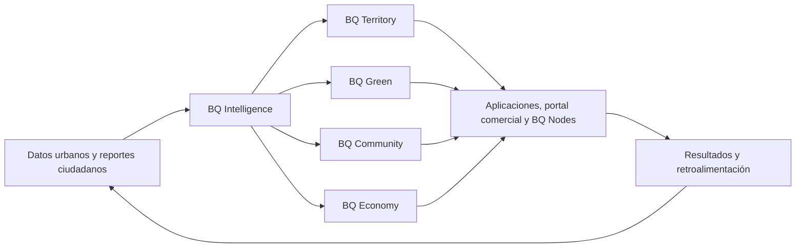

# BQ360 — Sprint 1 | Comprender y diseñar

> Una ciudad. Cinco dimensiones. Un futuro.

**QUIJAM — Bootcamp City Challenge** · Barranquilla 2034

## Estado del sprint

El Sprint 1 corresponde al póster y a la presentación de diagnóstico. Su resultado fue cerrar el problema, la propuesta de valor, los actores, las cinco dimensiones, la arquitectura inicial y el legado.

No corresponde a esta etapa implementar código, prometer integraciones institucionales ni presentar datos simulados como mediciones reales.

## Problema central

La limitada capacidad de coordinación y adaptación de los servicios urbanos ante incrementos masivos de demanda puede comprometer la movilidad, la atención, la sostenibilidad y la distribución equitativa de oportunidades.

**Causas por validar:**

- Fragmentación de información y responsabilidades entre actores urbanos.
- Concentración de visitantes en rutas y destinos similares.
- Barreras digitales, físicas, idiomáticas y económicas.
- Saturación de redes, transporte, servicios y espacios públicos.
- Presión climática por calor, lluvias y vulnerabilidad ambiental.

**Consecuencias:** congestión, saturación de destinos, exclusión, residuos, riesgos climáticos y deterioro de la experiencia diaria.

## Propuesta de valor

BQ360 propone un programa estratégico de inteligencia territorial que articula movilidad, sostenibilidad, datos, ciudadanía y economía. Conecta residentes, turistas, comercios y operadores mediante información compartida y recomendaciones coordinadas.

La solución no es solamente una aplicación turística. Es una plataforma complementaria a infraestructura física, señalización, participación comunitaria y coordinación institucional.

## Evidencia base

| Indicador | Dato | Fuente | Uso |
|---|---:|---|---|
| Población | 1.334.509 habitantes | DANE, 2024 | Contexto demográfico |
| PIB distrital | COP 40,7 billones | MinHacienda, 2023 | Contexto económico |
| Participación terciaria en el PIB | 79 % | MinHacienda, 2023 | Economía de servicios |
| Extensión distrital | 154 km² | Presentación oficial del bootcamp | Contexto territorial |

La sede del Mundial de 2034 es una premisa ficticia del reto. Los datos deben volver a verificarse antes de cualquier publicación institucional.

## Corredor piloto

El escenario inicial se concentra en:

```text
Estadio Metropolitano
        ↕
Transmetro y comercios barriales
        ↕
Gran Malecón del Río y Ciénaga de Mallorquín
```

El corredor permite demostrar movilidad, clima, comercio, inclusión y coordinación sin afirmar que toda Barranquilla cuenta con información o infraestructura evaluada.

## Actores y beneficiarios

- Residentes y ciudadanos.
- Turistas, hinchas y prensa acreditada.
- Comerciantes locales y emprendedores.
- Personas con discapacidad y adultos mayores.
- Operadores de transporte y escenarios deportivos.
- Alcaldía y secretarías municipales.
- Universidades, SENA y organizaciones comunitarias.

## Cinco dimensiones oficiales

| Dimensión | Aplicación de BQ360 | Legado |
|---|---|---|
| Ciudad y territorio | Movilidad predictiva, rutas accesibles y corredores turísticos. | Mejor movilidad y espacio público cotidiano. |
| Sostenibilidad | Alertas climáticas, residuos, hidratación y movilidad sostenible. | Resiliencia climática y economía circular. |
| Ciudad inteligente | Datos interoperables, mapa, simulación y asistencia. | Capacidad permanente de planificación. |
| Ciudadanía | Reportes, participación, cultura e inclusión. | Ciudadanía capacitada y apropiación comunitaria. |
| Economía y oportunidades | Comercio local, empleo, capacitación y rutas gastronómicas. | Fortalecimiento de la economía popular. |

## Arquitectura inicial



## Entregable del póster

El póster o presentación debe contener seis bloques:

1. Problema central y diagnóstico.
2. Propuesta de valor.
3. Actores y beneficiarios.
4. Las cinco dimensiones y sus conexiones.
5. Arquitectura inicial.
6. Legado después de 2034.

## Plan de validación

- Entrevistar residentes, asistentes a eventos y comerciantes.
- Revisar movilidad, accesibilidad, conectividad y clima del corredor.
- Confirmar fuentes oficiales de datos y capacidades reales.
- Registrar qué datos existen y cuáles son simulados.
- Medir comprensión del problema y utilidad percibida antes de ampliar el alcance.

## Resultado Sprint 1

Cierre conceptual y diagnóstico preparado para evolucionar hacia una demostración funcional en el Sprint 2.
