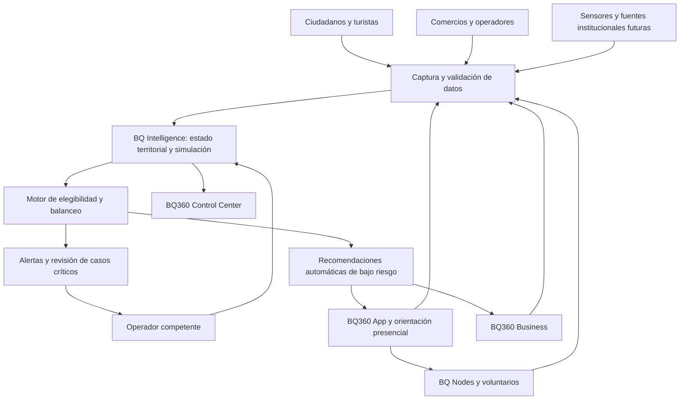

# BQ360 — Sprint 2 | Diseñar y construir

> Una ciudad. Cinco dimensiones. Un futuro.

**QUIJAM — Bootcamp City Challenge** · Barranquilla 2034 (escenario ficticio)

**Documento de diseño y planificación del Sprint 2.** Las funcionalidades descritas son entregables previstos; los escenarios son simulados.

## 1. Contexto y evolución del proyecto

BQ360 es un programa estratégico de inteligencia y transformación urbana que busca preparar Barranquilla para gestionar grandes concentraciones de personas, distribuir recursos y oportunidades, proteger la calidad de vida de los residentes y generar un legado permanente después del Mundial ficticio de 2034.

El Sprint 1 está cerrado. Se conserva su diagnóstico y se evoluciona la solución hacia un ecosistema automatizado, colaborativo y supervisado. Quilla3D es un antecedente conceptual, no una marca independiente.

El programa aborda la saturación como un problema de toda la cadena urbana: recorridos, cruces compartidos, destinos y servicios. La plataforma combina simulación, coordinación territorial, participación ciudadana y recomendaciones automatizadas para identificar cuándo redistribuir demanda es suficiente y cuándo se necesita una intervención física u operativa.

### Problema central

Capacidad limitada de coordinación y adaptación de los servicios urbanos ante picos de demanda, con riesgo de congestión, saturación de destinos, exclusión, impactos ambientales y distribución desigual de oportunidades económicas.

Hipótesis por validar: parte de la saturación podría reducirse mediante información compartida y distribución coordinada de la demanda. Si la capacidad física total es insuficiente, la plataforma no puede crear infraestructura ni garantizar atención: debe informar la demanda no atendida y escalar la situación.

### Propuesta de valor

BQ360 integra información territorial, participación ciudadana, disponibilidad de servicios y simulación de escenarios para generar recomendaciones diferenciadas y actualizarlas cuando cambian las condiciones. Su diferenciador propuesto es considerar conjuntamente la capacidad del recorrido y del destino, en lugar de recomendar una alternativa idéntica a todos. No se afirma exclusividad comercial sin investigación comparativa.

### Objetivo del Sprint 2

Estructurar el programa integral y construir una primera demostración de cómo BQ360 interpreta, anticipa y responde a cambios en la demanda urbana, integrando las cinco dimensiones del reto en un flujo verificable.

## 2. Requerimiento oficial 1 — Programa y componentes articulados

### 2.1 Cinco programas estratégicos

| Programa | Dimensión oficial | Intervención y conexión |
|---|---|---|
| BQ Territory | Ciudad y territorio | Movilidad, corredores, aforos, infraestructura, espacios públicos y accesibilidad. Proporciona capacidades y restricciones al motor. |
| BQ Green | Sostenibilidad | Calor, arroyos, hidratación, residuos, movilidad sostenible y economía azul y verde. Condiciona recomendaciones y localización de servicios. |
| BQ Intelligence | Ciudad inteligente | Datos, mapas, simulación, sensores futuros, reglas, recomendaciones y centro de control. Integra los demás programas. |
| BQ Community | Ciudadanía | Reportes, inclusión, cultura, educación, voluntariado y participación barrial. Aporta información y canales de orientación. |
| BQ Economy | Economía y oportunidades | Comercio local, turismo, empleo, capacitación y emprendimiento. Aporta disponibilidad y recibe oportunidades compatibles con la capacidad territorial. |

### 2.2 Pilares de innovación

1. **Representación urbana interactiva:** mapa con capas de movilidad, servicios, riesgos, accesibilidad y comercio. Evolución hacia un gemelo digital con datos calibrados y sincronizados; un mapa 3D por sí solo no constituye un gemelo digital operativo.
2. **Balanceo dinámico de flujos:** asignación de demanda a alternativas elegibles considerando capacidad de corredores y destinos, evitando concentración inducida por las propias recomendaciones.
3. **Inteligencia anticipativa:** simulación de llegadas, salidas, cierres y picos de demanda; proyección simple de ocupación en el MVP. Predicción estadística o IA entrenada únicamente cuando existan datos adecuados.
4. **Economía inteligente:** recomendaciones de negocios locales según servicios, disponibilidad, preferencias y criterios transparentes de distribución; sin obligación de compra para acceder a orientación o recarga gratuita cuando se acuerde.
5. **Inclusión:** información accesible, idiomas, orientación presencial y contenido estático disponible sin conexión. No prometer información en vivo sin conectividad ni accesibilidad física no verificada.
6. **BQ Nodes:** estaciones modulares de orientación, señalización, QR, hidratación, reciclaje y, según viabilidad, Wi-Fi, energía solar, carga y sensores. Prototipo conceptual inicialmente.
7. **Control Center:** mapa operativo, indicadores, simulación, alertas, trazabilidad y capacidad de intervención humana.

### 2.3 Capacidades digitales

BQ Move (movilidad), BQ Explore (turismo y cultura), BQ Safe (alertas y orientación), BQ Market (comercio), BQ Green (ambiente), BQ Health (hidratación y servicios de salud), BQ Jobs (empleo y capacitación), BQ Control (monitoreo), BQ AI (asistencia y análisis futuro) y **BQ Live (inteligencia colectiva urbana)**. Son capacidades transversales, no diez aplicaciones independientes. BQ Green puede designar tanto el programa como su capacidad digital; revisar nomenclatura sin perder la dimensión ambiental.

### 2.4 Arquitectura conceptual



El mapa, los estados de disponibilidad y el motor comparten una fuente lógica de información. Los cinco programas intervienen en cada decisión; las interfaces no deben convertirse en silos.

## 3. Requerimiento oficial 2 — Diseño y construcción del prototipo

### 3.1 Alternativas y alcance

| Alternativa | Ventaja | Límite |
|---|---|---|
| Ensayo de mesa y avisos manuales | Valida coordinación y retirada | No demuestra distribución inteligente ni comportamiento territorial |
| Mapa interactivo con simulación y reglas | Demuestra el diferenciador y permite repetir escenarios | Datos simulados; no equivale a operación real |
| Gemelo digital urbano conectado a sensores | Visión de largo plazo y análisis territorial avanzado | Requiere datos, calibración, permisos, infraestructura y mantenimiento |

Se recomienda la segunda alternativa para el MVP, conservando la primera como respaldo y la tercera como evolución. No reducir la visión estratégica por restricciones del prototipo.

### 3.2 Interfaces propuestas

- **BQ360 Control Center:** interfaz principal de demostración; mapa, ocupación, demanda, alertas, simulación y comparación de escenarios.
- **BQ360 App:** consulta de orientación, rutas, servicios, cultura, accesibilidad y reportes BQ Live.
- **BQ360 Business:** actualización de disponibilidad, servicios y cierre de recepción; puede representarse como panel dentro de la misma web.
- **BQ Nodes:** ficha, maqueta o modelo conceptual que reproduce orientación vigente y muestra su conexión con el sistema.

No es obligatorio construir tres aplicaciones separadas. Una sola web con vistas por rol puede demostrar el flujo completo.

### 3.3 Arquitectura funcional y motor inteligente

El simulador territorial es la pieza central del MVP. Se separan tres responsabilidades:

| Componente | Responsabilidad |
|---|---|
| BQ Digital Twin | Representación territorial interactiva; evolución hacia un gemelo digital calibrado. |
| BQ Predict | Reloj, demanda por intervalos, llegadas, salidas y proyección de ocupación. |
| BQ Flow Engine | Balanceo determinista de demanda con restricciones compartidas. |
| BQ Adaptive Routing | Elegibilidad y recomendaciones según necesidades de acceso, servicios y condiciones ambientales. |
| BQ Live | Reportes ciudadanos, pausa preventiva y revisión de incidencias. |
| BQ Market | Disponibilidad comercial y rotación transparente entre opciones equivalentes. |
| BQ Control Center | Comparación de políticas, supervisión, alertas y explicación de resultados. |
| BQ Nodes | Publicación presencial versionada y confirmación de retirada. |

El simulador estima estados futuros; el balanceador calcula alternativas; la capa de publicación aplica reglas de supervisión, vigencia y retirada. Los nombres identifican capacidades de una misma plataforma, no productos independientes.

#### Modelo territorial y temporal

Representar el territorio como un grafo de nodos y tramos. Cada ruta consume recursos compartidos y termina en un destino. Cada recurso registra identificador, unidad, intervalo, capacidad, estado, fuente y vigencia.

| Recurso | Unidad | Regla |
|---|---|---|
| Espacio o destino con aforo | Personas presentes | Ocupación siguiente = ocupación actual + llegadas − salidas; no exceder aforo operativo. |
| Tramo o cruce | Personas por intervalo | Sumar los pasos previstos de todas las rutas que lo utilizan; no exceder capacidad de paso. |
| Servicio de atención | Personas atendidas por intervalo | Limitar nuevas atenciones a la tasa disponible; conservar la cola pendiente. |

No sumar aforos y tasas como si fueran equivalentes. Las reservas de recomendaciones vigentes se descuentan una sola vez del recurso y del intervalo que corresponda. La capacidad de una ruta depende de todos sus recursos y de la compatibilidad del perfil de usuario.

#### Algoritmo de asignación inclusiva

1. Actualizar estados, vigencia y restricciones obligatorias: cierres, acceso vecinal, barreras, capacidad y compatibilidad de acceso.
2. Agrupar demanda por perfil y alternativas elegibles; priorizar grupos con menos opciones y reservar capacidad según una política explícita.
3. Ordenar alternativas válidas por tiempo, espera, exposición al calor y disponibilidad de servicios. Aplicar rotación comercial solo entre alternativas equivalentes.
4. Asignar lotes pequeños, descontando cada recurso compartido en su intervalo de uso. Registrar demanda pendiente si no existe capacidad.
5. Comparar la heurística con soluciones de referencia en casos pequeños; evaluar optimización de flujos o restricciones si se detectan pérdidas evitables o inequidad.
6. Publicar recomendaciones ordinarias automáticamente; escalar excepciones y cambios de operación a responsables competentes.

```text
para cada intervalo:
    actualizar ocupación, salidas, vigencia y restricciones
    incorporar nueva demanda y demanda pendiente
    ordenar perfiles por escasez de alternativas elegibles
    para cada perfil:
        seleccionar rutas compatibles y ordenar por costo
        asignar respetando todos los recursos y reservas
        registrar demanda no asignada y motivo
    proyectar llegadas y cargas
    publicar avisos vigentes y alertas
```

Distinguir demanda pendiente, recomendaciones emitidas, personas estimadas en tránsito y llegadas observadas. Al cambiar una condición, reasignar únicamente demanda aún redirigible; quienes ya están en tránsito requieren orientación específica en campo. El retiro digital no garantiza que una persona cambie de recorrido. Registrar aceptación de recomendaciones como parámetro de simulación, no como certeza.

### 3.4 Escenario demostrativo: salida del Metropolitano

Todos los datos son ficticios. Los corredores y sus capacidades no son estimaciones ni rutas verificadas de Barranquilla. La prueba utiliza 500 personas en un intervalo y tres políticas sobre la misma demanda y mapa.

| Recurso | Capacidad residual ilustrativa |
|---|---:|
| Ruta A | 50 |
| Cruce compartido por B y C | 430 |
| Destino B | 250 |
| Destino C | 180 |

Para esta prueba, los demás recursos tienen capacidad suficiente. B y C consumen el mismo cruce; su capacidad no se cuenta dos veces.

| Política | A | B | C | D | Pendientes | Interpretación |
|---|---:|---:|---:|---:|---:|---|
| Ruta más corta (A) | 50 | 0 | 0 | 0 | 450 | 500 intentos de paso, solo 50 admisibles; se forma cola. |
| Balanceo BQ360 | 50 | 250 | 180 | 0 | 20 | Se agotan el cruce y los destinos; no se fuerza una asignación. |
| Pausa preventiva de C antes de desplazarse | 50 | 250 | 0 | 0 | 200 | El destino B limita la redistribución aunque el cruce conserve capacidad. |
| Intervención ilustrativa: nuevo destino D con acceso independiente y 200 plazas | 50 | 250 | 0 | 200 | 0 | D recibe 200; exige autorización y capacidad física comprobada en operación real. |

La tercera política general (intervención urbana) también permite comparar salida escalonada en intervalos posteriores, únicamente si se libera capacidad. No supone que escalonar crea capacidad instantánea. La pausa de C es una perturbación aplicada a las políticas, no una cuarta política independiente.

**Prueba de inclusión:** 400 personas tienen varias alternativas y 100 necesitan C por accesibilidad. Reservar primero las plazas compatibles para estas últimas. Si C se cierra y no existe alternativa accesible, registrar esas 100 personas como pendientes de atención específica; no enviarlas por un recorrido incompatible. D solo puede atenderlas si cumple sus condiciones de acceso.

**Proyección temporal:** configurar demanda baja, media y alta, tasas de salida y porcentaje de aceptación de recomendaciones. Mostrar por intervalo cuándo aparece una cola, qué recurso se agota y cómo cambian las cargas. No presentar la proyección como predicción calibrada.

**Experiencia visual:** dos mapas sincronizados con grosor de línea proporcional al flujo, cuellos de botella, indicadores y línea de tiempo. Comparar políticas en el mismo instante; permitir seleccionar recursos y leer sus límites y motivos. La vista pública presenta orientación textual, vigencia, servicios y alternativas de acceso. Explorar perspectiva 2.5D, edificios elevados y flujos animados si los datos y el rendimiento lo permiten; conservar 2D como vista funcional y respaldo.

**Secuencia integrada:** un ciudadano reporta un arroyo en C; se activa una pausa preventiva acotada; el motor recalcula demanda redirigible; el operador revisa la incidencia; un comercio modifica su disponibilidad y el aviso se actualiza; el BQ Node retira la versión anterior y confirma el retiro. El centro de control compara una intervención autorizable con la situación sin intervención. Así las cinco dimensiones modifican la misma decisión, no son solo capas decorativas.

### 3.5 BQ Live — inteligencia colectiva urbana

Los usuarios pueden reportar aglomeraciones, barreras de accesibilidad, calles bloqueadas, arroyos, puntos saturados y fallas de servicios; también confirmar o controvertir reportes. Cada reporte incluye categoría, zona aproximada, hora, estado y fuente. Evitar datos personales innecesarios.

Estados sugeridos: recibido, pendiente, corroborado, verificado por operador, descartado y vencido. La confianza considera antigüedad, independencia de fuentes, coincidencia espacial y evidencia institucional. Las confirmaciones comunitarias no equivalen a verificación oficial. Incorporar límites de frecuencia, detección de duplicados y revisión de abuso; no usar votación popular como única prueba.

Para el MVP son indispensables un formulario de reporte, pausa preventiva acotada, estados visibles y revisión por operador. Las confirmaciones múltiples y la moderación avanzada son mejoras posteriores. No se requiere construir una red social ni un modelo de reputación complejo.

### 3.6 Automatización y supervisión humana

| Situación | Respuesta propuesta |
|---|---|
| Alternativas ordinarias con datos vigentes y condiciones elegibles | Recomendación automática dentro de reglas autorizadas |
| Reporte no corroborado de riesgo grave | Suspensión preventiva acotada de la alternativa afectada, alerta y revisión; no afirmar que el riesgo está confirmado. No levantar automáticamente la pausa si persiste incertidumbre relevante |
| Comercio confirma cierre o dato vence | Retirar automáticamente la recomendación y recalcular |
| Reportes contradictorios o falta de capacidad | Mostrar incertidumbre, no emitir orientación insegura y escalar al operador |
| Emergencia, cierre oficial o cambio de operación pública | Autoridad competente decide; BQ360 apoya y comunica, no sustituye protocolos oficiales |
| Aviso presencial invalidado | Voluntario retira la ficha y confirma; registrar pendiente si no hay acuse |

La supervisión humana es una capa de control, no una aprobación obligatoria de cada recomendación. Los ciudadanos aportan información; los comerciantes actualizan sus servicios; el motor analiza; los operadores intervienen en excepciones. Registrar motivo, versión, hora y rol de cualquier intervención. No permitir que una modificación manual ignore límites físicos o cierres oficiales.

### 3.7 Prioridades y arquitectura técnica

| Prioridad | Alcance |
|---|---|
| P0 indispensable | Mapa interactivo, motor con recursos compartidos, perfiles de acceso, reloj y tres políticas, demanda pendiente, reporte BQ Live, pausa y revisión, cambio comercial, aviso BQ Node versionado y retirada, datos simulados |
| P1 diferenciación | Confirmaciones comunitarias múltiples, moderación avanzada, filtros ampliados, traducción, 2.5D y animaciones, interfaces comerciales especializadas |
| P2 evolución | Predicción calibrada, gemelo digital conectado, sensores, multiusuario real, BQ Nodes equipados, empleo, incentivos y asistencia multilingüe avanzada |

El stack tecnológico propuesto para BQ360 integra desarrollo web, inteligencia territorial, optimización matemática y gestión de datos geoespaciales.

| Tecnología | Propósito |
| --- | --- |
| **Next.js** | Desarrollo de la plataforma web. |
| **TypeScript** | Desarrollo de código tipado, seguro y organizado. |
| **Tailwind CSS** | Diseño de interfaces modernas y adaptables. |
| **MapLibre GL JS** | Mapas interactivos 2D, 2.5D y visualización 3D. |
| **OpenStreetMap** | Información cartográfica del territorio. |
| **FastAPI** | Backend y servicios API. |
| **Python** | Algoritmos de balanceo, simulación y proyección de demanda. |
| **Google OR-Tools** | Optimización de flujos y distribución de recursos. |
| **PostgreSQL + PostGIS** | Almacenamiento y consultas de información geoespacial. |
| **WebSockets** | Actualización de información en tiempo real. |
| **OpenAI API** | Inteligencia artificial complementaria para reportes, traducción y explicaciones. |
| **Recharts** | Gráficos e indicadores del centro de control. |
| **Docker** | Portabilidad y reproducibilidad del entorno de desarrollo. |
| **GitHub** | Control de versiones y trabajo colaborativo. |

**Implementación progresiva:** el prototipo prioriza la plataforma web, el mapa interactivo, el motor determinista y los indicadores. El backend, la persistencia geoespacial, la sincronización y la IA se integran según las necesidades del desarrollo. La demostración contará con datos simulados y respaldo cartográfico local, respetando las licencias y atribuciones, sin depender de servicios de pago ni claves API. La IA complementa el sistema sin sustituir las restricciones verificables del motor. La visualización 3D aporta comprensión espacial sin comprometer la funcionalidad de la demostración.

La arquitectura separa los datos, el simulador temporal, el balanceador, la publicación y la presentación.

## 4. Requerimiento oficial 3 — Funcionamiento, recursos, actores y alianzas

### Modelo operativo

**Antes del evento:** identificar corredores y servicios, consultar residentes, revisar barreras, acordar capacidades, horarios, responsables, criterios comerciales y protocolos de suspensión.

**Durante:** recibir datos y reportes, validar vigencia, simular demanda, generar recomendaciones, supervisar excepciones, comunicar por canales digitales y presenciales y actualizar ante cambios.

**Después:** evaluar filas en origen y destino, incidencias barriales, participación comercial, comprensión de avisos y costos; ajustar el siguiente evento.

| Actor | Función |
|---|---|
| Residentes y visitantes | Consultar, reportar, confirmar y evaluar orientación |
| Comercios formales e informales | Informar disponibilidad, servicios y límites de recepción |
| Operadores urbanos y organizadores | Revisar excepciones, mantener datos y coordinar protocolos |
| Autoridades competentes | Autorizar intervenciones públicas y atender emergencias |
| Voluntarios | Orientar sin teléfono, recoger incidencias y retirar avisos vencidos |
| Equipo técnico | Mantener motor, datos, interfaces, seguridad y pruebas |
| Universidades y comunidades | Apoyar investigación, accesibilidad, capacitación y validación |

Aliados potenciales: Alcaldía y secretarías distritales, Transmetro, organizadores deportivos, organismos de socorro, instituciones de salud, universidades, SENA, Cámara de Comercio, asociaciones barriales y comerciales, organizaciones ambientales y de discapacidad, operadores de conectividad. No existen alianzas confirmadas en la información disponible.

Recursos del hackatón: equipo, portátiles, navegador, datos de ejemplo, cartografía o esquema local, ficha de campo y tiempo de prueba. Recursos del piloto: permisos, recorridos verificados, observadores, responsables por turno, señalización, conectividad, abastecimiento, soporte y presupuesto. Recursos de escalamiento: infraestructura de datos, mantenimiento, acuerdos de interoperabilidad, seguridad, personal y eventual equipamiento BQ Nodes.

Sostenibilidad financiera: calcular costo por turno (personal, agua, señalización, conectividad, soporte y contingencia), separar inversión y operación, explorar convenios público-privados, fondos de innovación y patrocinios transparentes. Mantener orientación esencial gratuita y evitar priorizar comercios únicamente por pago. No presentar financiación como asegurada.

Privacidad y seguridad: minimizar datos, usar conteos agregados, permisos por rol, caducidad, trazabilidad y protección contra reportes abusivos. No rastrear personas individualmente para la demo. En piloto, acordar responsable, finalidad, retención y controles antes de recopilar datos reales.

## 5. Requerimiento oficial 4 — Indicadores y hoja de ruta

### Indicadores técnicos del prototipo

| Indicador | Método | Criterio propuesto |
|---|---|---|
| Asignaciones por encima de capacidad | Contar recursos excedidos por ejecución | 0 en casos de prueba |
| Conservación de demanda | Asignada + pendiente frente a demanda total de cada lote; estados sin duplicación | Igualdad en cada ejecución |
| Equidad por perfil | Demanda asignada y pendiente por perfil; comparación con caso de referencia | No consumir capacidad exclusiva si existe una asignación compatible mejor |
| Carga compartida | Máximo de pasos asignados / capacidad por recurso e intervalo | ≤ 100 % en asignaciones controladas |
| Acuse presencial | Tiempo entre invalidación y confirmación de retiro | Medir por ensayo; mostrar pendientes |
| Saturación proyectada | Recursos por encima del umbral / recursos evaluados | Comparar escenario base y balanceado |
| Reacción a cambios | Tiempo desde cambio simulado hasta invalidación y recálculo | Medir y documentar; no prometer latencia real |
| Retirada de recomendaciones | Casos críticos retirados correctamente / casos ensayados | 100 % de casos críticos de demo |
| Comprensión y accesibilidad digital | Tareas completadas sin ayuda / intentos; revisión de teclado y contraste | Registrar resultados y corregir fallos críticos |

### Indicadores del programa y piloto

| Indicador | Método y fuente | Frecuencia / responsable |
|---|---|---|
| Tiempo de desplazamiento | Mediana de tiempos observados en franjas comparables | Por evento / movilidad |
| Espera en origen y destino | Observación de filas y demanda por intervalo | Por turno / territorio |
| Tiempo de detección y respuesta | Diferencia entre reporte, confirmación y actuación | Por incidencia / operador |
| Participación económica | Comercios activos / elegibles invitados; distribución de derivaciones | Por evento / enlace comercial |
| Variación de ventas | (Ventas piloto − línea base comparable) / línea base × 100, con consentimiento | Por evento / comercios |
| Aprovechamiento de residuos | Masa recuperada / masa generada en puntos medidos | Por evento / ambiente |
| Uso de hidratación | Recargas observadas por hora de servicio | Por turno / referente del punto |
| Cobertura de información accesible | Rutas con ficha vigente / rutas piloto | Antes del evento / accesibilidad |
| Capacitación y satisfacción | Participantes que completan formación; respuestas favorables / válidas | Por ciclo / comunidad |
| Sostenibilidad operativa | Costo por turno y turnos con responsable / previstos | Por evento / coordinación |

Las metas históricas (15 % menos tiempo de viaje, 30 % recuperación de residuos, 40 % menos tiempo de detección, 500 capacitados, 200 comercios, 10 % más ventas, 100 % de rutas piloto con información de accesibilidad y 85 % de satisfacción) son referencias preliminares, no compromisos ni resultados. Establecer línea base, plazo, muestra y meta aprobada antes del piloto. Comparar condiciones semejantes de asistencia, clima y operación; no atribuir causalidad sin evidencia suficiente.

### Hoja de ruta preliminar

| Etapa | Actividad | Condición para avanzar |
|---|---|---|
| Sprint 2 | Programa articulado, motor, mapa, simulación y documentación | Demo repetible y casos críticos aprobados |
| Sprint 3 | Validación con personas externas al diseño, iteración, pitch y video | Hallazgos, cambios y limitaciones registrados |
| 2026–2027 | Diagnóstico de campo, acuerdos y piloto en evento local | Responsable, permisos, línea base y presupuesto |
| 2028–2029 | Integración de servicios y corredores estratégicos | Datos vigentes, interoperabilidad y operación segura |
| 2030–2031 | Expansión, capacitación y BQ Nodes piloto | Evaluación de impacto y mantenimiento financiado |
| 2032–2033 | Pruebas de estrés y simulacros de eventos masivos | Protocolos y resultados aceptados por responsables competentes |
| 2034 | Operación en el escenario ficticio del Mundial | Monitoreo, revisión por turno y evaluación |
| 2035 en adelante | Carnaval, partidos, turismo, cultura y gestión cotidiana | Titular operativo, presupuesto y uso recurrente |

## 6. Sprint Backlog y planificación

No se fija duración sin confirmar tiempo, habilidades y número de integrantes. Las prioridades pueden ajustarse, pero preservar el flujo principal de inteligencia territorial.

| ID | Historia / tarea | Prioridad | Dependencia | Rol / esfuerzo relativo | Aceptación |
|---|---|---|---|---|---|
| S2-01 | Como equipo, definir escenario y datos | P0 | Ninguna | Producto / bajo | Capacidades, intervalos y supuestos explícitos |
| S2-02 | Como operador, visualizar zonas y servicios | P0 | 01 | Frontend / medio | Mapa interactivo con estados legibles y recursos compartidos |
| S2-03 | Como visitante, recibir alternativa sin sobrecargar recursos | P0 | 01 | Motor / medio | Respeta capacidad compartida y conserva demanda |
| S2-04 | Como jurado, comparar escenarios | P0 | 02,03 | Frontend y motor / medio | Tres políticas reproducibles con la misma demanda y reloj |
| S2-05 | Como ciudadano, informar una incidencia | P0 | 01,03 | Desarrollo / medio | Reporte modifica estado según regla y genera recálculo o revisión |
| S2-06 | Como operador, gestionar cierre y excepción | P0 | 03,05 | Desarrollo / medio | Retirada, alerta, motivo y demanda no atendida |
| S2-07 | Como comercio, actualizar recepción | P0 | 03 | Desarrollo / bajo | Cierre invalida destino y actualiza orientación |
| S2-08 | Como persona sin teléfono, recibir orientación vigente | P0 | 06 | UX y operación / bajo | Ficha BQ Node con vigencia y retirada confirmada |
| S2-09 | Como usuario, comprender el mapa y servicios | P1 | 02 | UX / medio | Capas, contraste, teclado y 3D si es viable |
| S2-10 | Como equipo, verificar y documentar | P0 | 04,06 | QA y comunicación / medio | Pruebas, instrucciones, decisiones y demo repetible |
| S2-11 | Como usuario con necesidades de acceso, recibir una alternativa compatible | P0 | 01,03 | Motor y UX / medio | Prioridad de perfiles con menos alternativas y demanda pendiente por perfil |
| S2-12 | Como operador, proyectar demanda e intervenir sobre el escenario | P0 | 03,04 | Motor y frontend / medio | Reloj, tres políticas y explicación de cuellos de botella |

Orden de trabajo: acordar escenario y alcance; desarrollar mapa y motor en paralelo; integrar simulación y cambios; añadir capas e interfaces según tiempo; reservar un bloque final para pruebas y presentación. Si falta tiempo, recortar detalle 3D, interfaces independientes y funcionalidades secundarias antes que el motor de distribución. Si falla el mapa externo, usar esquema local interactivo. Si falla una integración, declarar qué quedó pendiente.

### Pruebas de aceptación y definición de terminado

- Escenario nominal y tres políticas reproducibles desde reinicio, con resultados esperados de 480 asignados y 20 pendientes; tras pausa de C, 300 asignados y 200 pendientes.
- Pruebas de recursos compartidos, perfiles con menos alternativas, ocupación entre intervalos y personas en tránsito; no reasignar retroactivamente desplazamientos iniciados.
- Cambio comercial y retiro de aviso presencial versionado con acuse independiente.
- Capacidad de corredor y destino respetada, incluidos recursos compartidos.
- Demanda superior a capacidad registrada como no atendida.
- Cierre, caducidad y riesgo reportado invalidan alternativas según reglas.
- Reportes contradictorios muestran incertidumbre y permiten revisión.
- Recomendación ordinaria automática y excepción supervisada demostrables.
- Sin red, la demo conserva un escenario local; no muestra datos antiguos como actuales.
- Interfaz con texto además de colores, foco visible y navegación por teclado.
- Datos ficticios identificados; limitaciones y resultados de pruebas registrados.
- Probar retirada y acuse presencial separado del aviso digital.

Entregables: programa estructurado, arquitectura, prototipo inicial, escenario de datos, matriz de pruebas, indicadores, hoja de ruta, registro de decisiones y guion de demostración. No se declara terminado hasta ejecutar las pruebas aplicables.

## 7. Validación, riesgos y defensa ante el jurado

Validar hipótesis con residentes, operadores y comercios mediante entrevistas breves y observación de eventos comparables. Preguntar quién conoce la capacidad, cómo cambia la información y si existen alternativas utilizables. Si la limitación es exclusivamente física, replantear la intervención. Comparar también con el procedimiento verbal habitual para comprobar el aporte de digitalizarlo.

| Riesgo | Mitigación |
|---|---|
| Trasladar congestión | Capacidad de recorrido y destino, márgenes y medición en ambos puntos |
| Datos falsos o antiguos | Vigencia, fuentes independientes, revisión y suspensión preventiva |
| Exceso de alcance | MVP integrado, prioridades y recortes de presentación antes del núcleo |
| Exclusión digital o física | Canal presencial, pruebas con usuarios y verificación de trayectos |
| Falta de datos reales | Simulación explícita y plan de validación |
| Dependencia institucional | Aliados potenciales, permisos y responsables antes de pilotar |
| Costos y mantenimiento | Presupuesto por turno y evaluación antes de adquirir hardware |
| Desigualdad comercial | Criterios transparentes, rotación y acceso sin obligación de compra |

### Rúbrica QUIJAM

| Criterio | Peso | Evidencia propuesta |
|---|---:|---|
| Visión estratégica e integralidad | 20 % | Cinco programas, operación y legado |
| Integración de dimensiones | 15 % | Una decisión conecta movilidad, ambiente, datos, ciudadanía y economía |
| Madurez del prototipo | 15 % | Motor funcional, simulación y recálculo |
| Comprensión del problema | 10 % | Hipótesis, causas y límites físicos |
| Innovación y diferenciación | 10 % | Balanceo de capacidad e inteligencia colectiva supervisada |
| Viabilidad, sostenibilidad e impacto | 10 % | Recursos, indicadores y piloto |
| Evolución y colaboración | 10 % | Registro de decisiones, pruebas e iteraciones |
| Comunicación, presentación y video | 10 % | Historia visual, demostración y legado |

### Guion sugerido (4 minutos)

1. 35 s: presentar el problema de concentración y su efecto en residentes y visitantes.
2. 45 s: mostrar el mapa, capas y cinco dimensiones.
3. 60 s: simular demanda y comparar ruta corta, balanceo e intervención urbana.
4. 45 s: reportar un riesgo o cerrar un destino, mostrar retirada, recálculo y supervisión.
5. 35 s: explicar comercio local, inclusión presencial, indicadores y continuidad.
6. 20 s: cerrar con el alcance real de la demo y visión de futuro.

## 8. Entregables del Sprint 2

El sprint comprende el programa estratégico articulado, el diseño técnico, la primera versión demostrable del simulador territorial, el modelo operativo, los indicadores y la hoja de ruta. La evidencia incluye escenarios reproducibles, matriz de pruebas, registro de cambios, ficha BQ Node y guion de demostración.

La implementación se organiza por dependencias y prioridades, sin fijar una duración ni un stack no sustentados. El alcance funcional se concentra en el circuito completo de simulación, recomendación, incidencia, recálculo, intervención y comunicación. La expansión a sensores, predicción calibrada y equipamiento físico pertenece a la evolución progresiva del programa.

**Principio rector:** adaptar el prototipo para demostrar la esencia de BQ360, no reducir la esencia de BQ360 al prototipo.

> El mundo viene. Barranquilla evoluciona.
