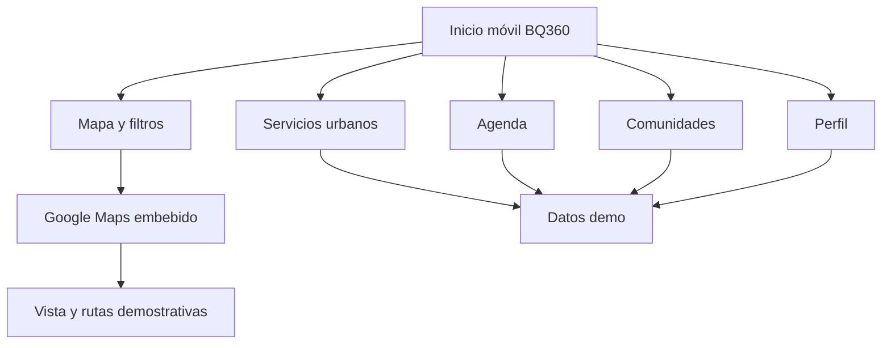

# BQ360 — Sprint 3 | Validar y consolidar

> Una ciudad. Cinco dimensiones. Un futuro.

**QUIJAM — Bootcamp City Challenge** · Barranquilla 2034

## Estado del sprint

El Sprint 3 transforma el prototipo del Sprint 2 en una solución completa demostrable: interfaz móvil, mapa real embebido, módulos urbanos, datos de ejemplo, recorrido integrado, validación y presentación final.

Las cifras, recomendaciones, reportes y estados operativos actuales son simulados. Ninguna integración institucional debe presentarse como activa sin evidencia verificable.

## Solución implementada

BQ360 se presenta como una aplicación móvil responsive y adaptada a PWA. El primer nivel ofrece una vista funcional de Barranquilla con navegación para movilidad, cultura, servicios, comercio y perfil ciudadano.

### Experiencia principal

- Inicio móvil de una sola pantalla.
- Brand y navegación inspirados en los colores y formas de Barranquilla.
- Líneas, rutas y formas animadas integradas en la interfaz.
- Estado de movilidad y ambiente en tiempo real conceptual.
- Acceso rápido a módulos y recomendaciones cercanas.
- Navegación inferior para inicio, mapa, reportes, agenda y perfil.
- Menú lateral accesible y estados táctiles.

### Mapa

La vista previa y el modo a pantalla completa utilizan Google Maps embebido sin API key. Los filtros permiten explorar:

- Barranquilla completa.
- Movilidad y Transmetro.
- Cultura y Gran Malecón.
- Comercio y centro histórico.
- Accesibilidad.

Para geolocalización dinámica, marcadores propios, rutas calculadas y datos operativos en vivo se requiere Google Maps JavaScript API y fuentes territoriales autorizadas.

### Módulos funcionales

| Módulo | Estado demo |
|---|---|
| BQ Move | Rutas, transporte, movilidad y filtros. |
| BQ Explore | Lugares, cultura y destinos cercanos. |
| BQ Safe | Alertas, orientación y puntos seguros conceptuales. |
| BQ Market | Comercios y economía local de ejemplo. |
| BQ Green | Residuos, clima y prácticas sostenibles. |
| BQ Health | Hidratación y prevención climática. |
| BQ Jobs | Representado en el programa y pendiente de interfaz. |
| BQ Live | Reportes pendientes de integración persistente. |
| BQ Control | Concentrado en estado urbano y recomendaciones. |
| BQ AI | Asistente pendiente de integración responsable. |

### Datos y persistencia

El prototipo no requiere una base de datos para ejecutarse. Los datos demo están centralizados en:

- `docs/BQ360_Datos_Demo.md`
- `BQ360/lib/demo-data.ts`

Incluyen perfil, eventos, comunidades, lugares, alertas y agenda. Estos datos pueden ser sustituidos por fuentes reales y persistencia posterior.

## Arquitectura frontend



Stack actual:

- Next.js.
- React.
- Tailwind CSS y estilos propios.
- Lucide Icons.
- Datos locales TypeScript.
- Google Maps Embed.

## Validación prevista

Realizar pruebas de tareas con personas externas al equipo:

1. Encontrar una ruta de transporte.
2. Localizar un lugar cultural.
3. Filtrar comercio accesible.
4. Consultar una alerta ambiental.
5. Encontrar el perfil y la agenda.

Registrar tiempo de tarea, éxito, confusión, barreras de acceso y comentarios. Priorizar fallos que impidan comprender la recomendación o navegar sin ayuda.

## Requisitos de consolidación

- Diferenciar datos reales, estimaciones y simulaciones en cada pantalla.
- Conservar un lenguaje claro y evitar afirmaciones institucionales no verificadas.
- Revisar contraste, zoom, teclado y orientación móvil.
- Explicar cuando una recomendación necesita confirmación humana.
- Documentar cada iteración posterior al test.
- Preparar demostración, presentación y video máximo de cinco minutos.

## Hoja de ruta posterior

| Etapa | Alcance |
|---|---|
| 2026–2027 | Validación, línea base, alianzas y piloto local. |
| 2028–2029 | Integración de servicios y corredores. |
| 2030–2031 | Expansión y capacitación. |
| 2032–2033 | Pruebas de estrés y simulacros. |
| 2034 | Operación del escenario ficticio. |
| 2035 en adelante | Carnavales, partidos, turismo y vida cotidiana. |

## Cómo ejecutar el prototipo

```powershell
cd C:\Users\USUARIO\OneDrive\Desktop\brandonquijam\quijam-2026\BQ360
& "C:\Program Files\nodejs\npm.cmd" run dev
```

Abrir `http://localhost:3000`.

## Entregable de Demo Day

La presentación final debe narrar:

1. Problema y población afectada.
2. Integración de las cinco dimensiones.
3. Solución BQ360 y demo móvil.
4. Funciones implementadas y datos simulados.
5. Validación, iteraciones y limitaciones.
6. Impacto, sostenibilidad y legado.
