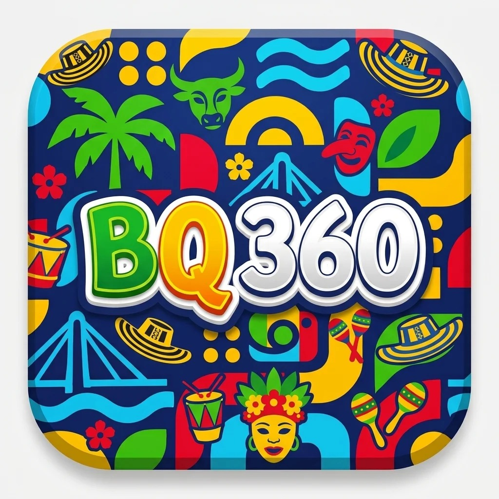

# BQ360 — Dossier de investigación Sprint 1

**Propuesta integrada:** **BQ360** integra un programa estratégico territorial con una capa operativa 3D de orientación, balanceo de flujos y resiliencia. El piloto se valida en un corredor real antes de escalar a toda la ciudad.

## 1. Enfoque unificado

### Integración en una sola plataforma: BQ360

El programa combina dos capas complementarias bajo **BQ360**:

- **Capa estratégica territorial:** programa estratégico territorial, enfoque en fragmentación urbana entre cuatro actores, caso demostrativo de un partido en el Estadio Metropolitano y plan de validación en campo.
- **Capa operativa 3D y resiliencia:** diferenciador técnico y local con balanceo dinámico por capacidad en tiempo real, mapa 3D Ciudad-Estadio, resiliencia offline-first con degradación a 2D, tótems físicos con QR/Wi-Fi, atención a prensa acreditada, alertas de calor/arroyos y protección ambiental.

### Diferenciador frente a Google Maps y Waze

La propuesta no compite solo por “mejor ruta”. Su valor está en integrar:

- Aforo y capacidad de los escenarios.
- Congestión y alternativas de movilidad.
- Clima, calor y riesgo hídrico.
- Comercios barriales y economía popular.
- Accesibilidad universal.
- Información oficial para visitantes, prensa y autoridades.
- Modo degradado para contextos de baja conectividad.

### Legado post-2034

La plataforma no se apaga después del Mundial. Puede permanecer como un gemelo digital ciudadano para:

- Carnaval y eventos culturales.
- Activación de escenarios deportivos.
- Gestión de emergencias climáticas.
- Educación y datos abiertos.
- Movilidad y comercio local.

## 2. Ajustes obligatorios

### Corregir cifras contradictorias

Eliminar los datos no verificados de `BQ360.md`:

- “1.248.000 habitantes”.
- “PIB de $46,8 billones”.

Usar en su lugar:

| Dato | Valor oficial | Fuente y alcance |
|---|---:|---|
| Población de Barranquilla | 1.334.509 habitantes | DANE, proyecciones 2024 |
| Superficie distrital | 154 km² | MinHacienda |
| PIB distrital 2023 | $40,7 billones | MinHacienda |
| Estructura económica | 79 % servicios | MinHacienda, PIB 2023 |
| Capacidad del Estadio Metropolitano | 42.700 espectadores | Alcaldía de Barranquilla |

**Regla:** todo dato nuevo debe indicar fuente, año y alcance.

### Usar las cinco dimensiones oficiales

Mapear explícitamente las iniciativas bajo las cinco dimensiones:

1. Ciudad y territorio.
2. Sostenibilidad.
3. Ciudad inteligente.
4. Ciudadanía.
5. Economía y oportunidades.

### Delimitar un escenario piloto

No abarcar genéricamente “toda Barranquilla”. El diagnóstico y la demostración deben centrarse en un corredor concreto:

**Estadio Metropolitano ↔ Transmetro y comercios barriales ↔ Gran Malecón / Ciénaga de Mallorquín.**

La propuesta debe mostrar cómo este corredor escala posteriormente al resto de la ciudad mediante módulos territoriales.

### Cubrir las lecciones faltantes

Incluir realismo presupuestal y cumplimiento a tiempo:

- Los megaeventos suelen superar presupuestos y enfrentar retrasos.
- La experiencia de los Juegos Panamericanos 2027 en Barranquilla debe usarse como lección de planeación, no como cifra no verificada.
- La cifra de “172 % de sobrecosto” no debe presentarse como dato local confirmado sin fuente primaria, período, muestra y moneda.
- Distinguir claramente qué fuentes de datos existen hoy y cuáles serán simuladas.

### Respetar el alcance del Sprint 1

Dejar para el Sprint 2:

- Desarrollo técnico.
- Stack tecnológico.
- Los nueve módulos completos.

El foco del Sprint 1 es cerrar:

- Diagnóstico con causas raíz.
- Actores.
- Problema central.
- Propuesta de valor.
- Arquitectura inicial.
- Mapa de las cinco dimensiones.

## 3. Estructura del entregable

El póster o presentación del Sprint 1 debe organizarse en seis bloques:

### 1. Problema central y diagnóstico

Incluir cifras locales verificadas y separar síntomas de causas raíz.

**Síntomas:**

- Congestión hacia el Estadio Metropolitano.
- Saturación de servicios y espacios públicos.
- Pérdida de clientes en comercios cercanos.
- Desinformación del turista y la prensa.
- Exposición a calor y riesgos hídricos.

**Causas raíz:**

- Fragmentación urbana y de datos.
- Efecto rebaño: todos los flujos convergen a las mismas rutas.
- Brecha digital y baja accesibilidad.
- Presión climática y ambiental.
- Débil visibilidad de la economía popular.

### 2. Propuesta de valor

**Mapa 3D Ciudad-Estadio con balanceo dinámico por aforo.**

Componentes:

- Web ligera y offline-first.
- Accesibilidad universal.
- Tótems físicos 3D con QR/Wi-Fi.
- Rutas alternativas según capacidad, clima y evento.
- Información para turistas, prensa, comercios y autoridades.

### 3. Mapa de actores y beneficiarios

| Actor | Rol | Beneficio esperado |
|---|---|---|
| Turistas y prensa | Reciben rutas, alertas e información oficial | Menor incertidumbre, mejor experiencia |
| Ciudadanía | Reporta y recibe información accesible | Movilidad más segura e informada |
| Comercios locales | Se visibilizan en el corredor | Mayor flujo y demanda predecible |
| Autoridades y entidades | Coordinan datos, movilidad y respuesta | Mejor toma de decisiones y prevención |

### 4. Cinco dimensiones oficiales

| Dimensión | Aporte concreto |
|---|---|
| Ciudad y territorio | Corredor Ciudad-Estadio como unidad piloto y mapa 3D de rutas, accesos y comercios |
| Sostenibilidad | Alertas de calor, rutas seguras, gestión de residuos y protección ambiental |
| Ciudad inteligente | Motor de balanceo por aforo, integración de datos abiertos y tablero de control |
| Ciudadanía | Información accesible, participación ciudadana, tótems físicos y canales de reporte |
| Economía y oportunidades | Visibilidad de comercios, rutas de consumo local, información multilingüe y medición de demanda |

### 5. Arquitectura inicial

**Flujo funcional:**

`Datos urbanos y aforo → Motor de balanceo 3D e IA → Interfaces`

**Entradas:**

- Datos abiertos de movilidad.
- Rutas y estaciones de Transmetro.
- Datos climáticos de IDEAM.
- Capacidad del Estadio Metropolitano.
- Inventario de comercios.
- Reportes ciudadanos.
- Sensores o aforo en tiempo real, cuando estén disponibles.

**Motor:**

- Calcula rutas.
- Estima congestión.
- Genera alertas.
- Propone alternativas según capacidad, clima y evento.

**Salidas:**

- Mapa 3D y web ligero.
- Recomendaciones de ruta.
- Alertas preventivas.
- Panel de control para autoridades.
- Contenido para tótems QR/Wi-Fi.

**Modo degradado:**

Si no hay conectividad o datos en tiempo real, la plataforma debe degradar a:

- Mapa 2D.
- Rutas precalculadas.
- Señalización física.
- Alertas básicas.

### 6. Legado post-2034

La plataforma debe reutilizarse permanentemente en:

- Carnaval.
- Escenarios deportivos.
- Emergencias climáticas.
- Educación con datos abiertos.
- Movilidad y comercio local.

## 4. Plan de investigación priorizado

### Territorio y movilidad

Confirmar:

- Cifras oficiales DANE y PIB.
- Capacidad del Estadio Metropolitano.
- Vías que colapsan.
- Cobertura de Transmetro.
- Conectividad desde el Aeropuerto Ernesto Cortissoz.
- Estado de accesibilidad física.

**Datos ya identificados:**

- El Estadio Metropolitano tiene capacidad oficial de 42.700 espectadores.
- La Alcaldía y Transmetro disponen de la ruta alimentadora A3-31 hacia el Aeropuerto Ernesto Cortissoz.
- En la final Sudamericana de noviembre de 2026, la Alcaldía reportó 26 de 94 rutas del área metropolitana conectando el sector del estadio con zonas del norte y centro.
- Existen datos abiertos de perfiles viales, accidentalidad, fotodetección, comparendos e inmovilizaciones.

### Clima y sostenibilidad

Investigar:

- Temperatura y sensación térmica.
- Arroyos críticos en vías de acceso.
- Presión ambiental en el Gran Malecón, Río Magdalena, Ciénaga de Mallorquín y playas cercanas.
- Manejo de residuos en eventos masivos.

**Formulación prudente para el póster:**

> “El corredor puede experimentar simultáneamente alta sensación térmica, concentración peatonal y presión sobre la red hídrica y los ecosistemas cercanos; el sistema priorizará alertas preventivas y rutas seguras.”

**Fuentes disponibles:**

- IDEAM publica boletines climatológicos diarios y series de temperatura y precipitación para Barranquilla.
- Los datos específicos de arroyos, presión ambiental y residuos deben validarse antes de afirmarse como hechos.

### Conectividad y datos

Investigar:

- Saturación de red móvil cerca del estadio.
- Cobertura de Wi-Fi público.
- Fuentes de datos abiertos existentes.
- Referentes reales de gemelos digitales urbanos.

**Datos disponibles:**

- La Alcaldía de Barranquilla publica datos abiertos en su portal y en datos.gov.co.
- Existen conjuntos de perfiles viales, accidentalidad, fotodetección, comparendos e inmovilizaciones.
- El Área Metropolitana de Barranquilla también dispone de un portal de datos abiertos.

**Clasificación obligatoria:**

| Tipo de dato | Estado |
|---|---|
| Datos abiertos de movilidad y tránsito | Disponible |
| Clima y precipitación IDEAM | Disponible |
| Capacidad del estadio | Disponible |
| Aforo en tiempo real | Simulado / convenio futuro |
| Sensores de ocupación | Simulado / convenio futuro |
| Cámaras integradas en tiempo real | Simulado / convenio futuro |
| Predicción de arroyos | Simulado / validación pendiente |
| Saturación de red móvil | Simulado / validación pendiente |

### Inclusión y validación en campo

Investigar:

- Cifras de población con discapacidad o movilidad reducida.
- Quejas frecuentes en eventos masivos.
- Entrevistas cortas con comerciantes, asistentes y ciudadanos.

**Regla:** no usar un porcentaje de discapacidad sin citar año, operación estadística y definición.

**Validación mínima:**

Realizar entre 3 y 5 entrevistas breves en el corredor:

1. Un comerciante cercano al Estadio Metropolitano.
2. Un usuario habitual de Transmetro.
3. Un asistente a un partido o evento.
4. Un residente de un barrio del corredor.
5. Un funcionario o agente de movilidad, si es posible.

**Preguntas sugeridas:**

1. ¿Qué le complica más asistir o trabajar durante un evento masivo?
2. ¿Cómo decide hoy su ruta hacia o desde el estadio?
3. ¿Qué información le falta antes y durante el evento?
4. ¿Qué riesgos climáticos o de movilidad ha experimentado?
5. ¿Qué beneficios esperaría de un mapa con rutas, comercios y alertas?
6. ¿Qué barreras de pago, idioma, accesibilidad o conectividad enfrenta?

### Economía popular

Investigar:

- Tasa de informalidad laboral.
- Caracterización de pequeños comercios barriales.
- Concentración del gasto turístico.
- Barreras prácticas: idioma, pagos y visibilidad.

**Datos verificables:**

- Barranquilla A.M. registró una informalidad de 55,3 % en 2024.
- En el trimestre febrero–abril de 2025, la informalidad bajó a 49,5 %.
- La Alcaldía reportó que Barranquilla A.M. fue la ciudad con la mayor reducción de informalidad entre las 23 principales del país, según DANE-GEIH.

**Formulación prudente:**

> “El sistema busca aumentar la visibilidad, la predictibilidad de demanda y la capacidad de los comercios del corredor para captar el flujo de visitantes; el impacto se medirá con una línea base previa al piloto.”

### Gobernanza y legado

Identificar entidades reales que sostendrían el programa:

- Alcaldía de Barranquilla.
- Secretarías distritales.
- Barranquilla Verde.
- Transmetro.
- Cámara de Comercio.
- Universidades.
- SENA.
- Organizadores de eventos.
- Prensa acreditada.

**Evidencia de legado:**

- Los Juegos Centroamericanos y del Caribe 2018 dejaron 13 escenarios con estándares internacionales.
- La Alcaldía y Mindeporte han retomado diálogos sobre los Juegos Panamericanos 2027, con énfasis en optimizar infraestructura existente.

## 5. Mensaje central para el póster

> **BQ360 integra gobernanza, diagnóstico territorial y validación en campo con una capa operativa 3D de orientación, balanceo de flujos y resiliencia. El piloto se valida en un corredor real antes de escalar a toda la ciudad.**

## 6. Qué afirmar y qué no afirmar

| Puede afirmarse con fuente | Debe marcarse como hipótesis, simulación o validación pendiente |
|---|---|
| Población, superficie, PIB y estructura económica | Aforo en tiempo real y saturación de red móvil |
| Capacidad del estadio: 42.700 espectadores | Predicción de arroyos y alertas automáticas |
| Rutas Transmetro y conexión con el aeropuerto | Impacto económico medido en comercios |
| Informalidad laboral 55,3 % en 2024 y 49,5 % en 2025 | Cobertura exacta de Wi-Fi público |
| Datos abiertos de tránsito, accidentalidad, fotodetección y perfiles viales | Disponibilidad de cámaras integradas en tiempo real |
| Legado de 13 escenarios de 2018 | Estado operativo actual de cada escenario |
