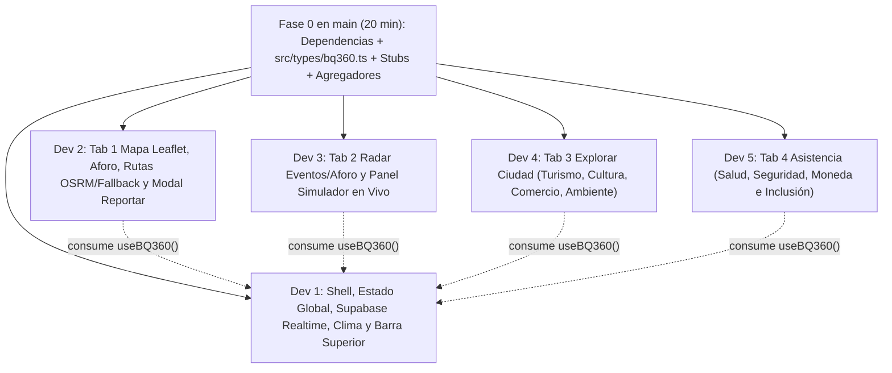

# Plan de Desarrollo en Paralelo (5 Personas) — BQ360

> **Proyecto:** BQ360 (`Quijam-2026`) — Barranquilla 2034 & Legado Post-Mundial  
> **Especificación de producto:** Ver [BQ360.md](./BQ360.md)  
> **Stack base del repo:** Next.js `16.4.6` (App Router, `cacheComponents: true`) · React `19.3.0` · TypeScript `5` · Tailwind CSS `4.3.3` · Supabase (`bbxhxmalkvehkiipvsfc`)

---

## 1. Estrategia Cero-Conflictos

Para que **5 personas programen al tiempo sin pisarse los archivos en Git**, el proyecto sigue una arquitectura de **Fase 0 Congelada + 5 Cortes Verticales Exclusivos**:



### Las 5 reglas de oro para no tener conflictos de Merge
1. **`package.json` se congela en Fase 0:** Todas las librerías se instalan una sola vez en `main` antes de crear las ramas. Ningún dev instala paquetes en su rama sin acordarlo en `main`.
2. **Solo Dev 1 toca `src/app/*`:** En Fase 0, `src/app/page.tsx` ya importa los 5 componentes *stub* (`MapTab`, `EventsTab`, `ExploreTab`, `AssistanceTab`, `SimulatorDrawer`). Los Devs 2–5 **nunca** editan `page.tsx`, `layout.tsx` ni `globals.css`.
3. **`i18n` dividido en 5 archivos independientes:** En vez de un único archivo de traducciones (choque garantizado), cada dev tiene su propio diccionario (`src/i18n/shell.ts`, `map.ts`, `events.ts`, `explore.ts`, `assistance.ts`) y `src/i18n/index.ts` (congelado en Fase 0) los fusiona automáticamente.
4. **Datasets de Barranquilla divididos por dueño:** Cada dev edita solo su archivo de datos (`routes-fallback.ts`/`arroyos.ts`, `events.ts`/`scenarios.ts`, `explore-pois.ts`, `assistance-pois.ts`/`currency-rates.ts`). Un agregador congelado `src/data/all-pois.ts` junta `explore-pois` + `assistance-pois` para que el Mapa muestre las 7 capas sin tocar código ajeno.
5. **Regla técnica Next.js 16 (`cacheComponents: true`):** `next.config.ts` tiene `cacheComponents: true` y `partialPrefetching: true`. Todos los componentes interactivos usan `"use client"`, y Leaflet (`window`/`document`) **siempre** se carga mediante `next/dynamic(() => import("./LeafletCanvas"), { ssr: false })`.

---

## 2. Asignación del Equipo (Equitativa)

> Completen la columna **Integrante** antes de arrancar Fase 0.

| Rol | Integrante | Rama Git | Foco principal | Dimensiones QUIJAM que cubre |
| :--- | :--- | :--- | :--- | :--- |
| **Dev 1** | *(Asignar)* | `feat/dev1-shell-realtime` | Fase 0, Shell Mobile-First, Estado Global, Supabase Realtime, Clima y Barra Transversal | Ciudad inteligente · Sostenibilidad · Ciudadanía |
| **Dev 2** | *(Asignar)* | `feat/dev2-map-routing` | **Core:** Mapa real de Barranquilla (Leaflet), Zonas de Aforo/Arroyos, Rutas Alternativas (OSRM + fallback) y Modal `+ Reportar` | Ciudad y territorio · Sostenibilidad · Ciudad inteligente |
| **Dev 3** | *(Asignar)* | `feat/dev3-events-simulator` | **Core:** Pestaña 2 (Radar Eventos/Aforo Mundial 2034 ↔ Legado) y Panel Simulador en Vivo (`Sync` vs. `Local`) | Ciudad inteligente · Legado Post-2034 |
| **Dev 4** | *(Asignar)* | `feat/dev4-explore-city` | Pestaña 3: Explorar Ciudad (Turismo, Cultura, Comercio local con precios convertidos y Ambiente) | Economía y oportunidades · Sostenibilidad · Ciudadanía |
| **Dev 5** | *(Asignar)* | `feat/dev5-assistance-inclusion` | Pestaña 4: Asistencia (Salud, Seguridad "más cercano", Conversor Tasa Monetaria y Centro de Inclusión) | Ciudadanía · Economía · Ciudad y territorio |

---

## 3. Matriz Estricta de Propiedad de Archivos

> **Regla absoluta:** Solo puedes crear o editar archivos dentro de las rutas de tu fila. Los archivos marcados como **Congelados (Fase 0)** no se modifican durante el desarrollo paralelo.

| Dueño | Carpetas y archivos EXCLUSIVOS |
| :--- | :--- |
| **Congelados (Fase 0 — solo `main`)** | `package.json`, `package-lock.json`, `next.config.ts`, `tsconfig.json`, `src/types/bq360.ts`, `src/i18n/index.ts`, `src/data/all-pois.ts` |
| **Dev 1** | `src/app/layout.tsx`, `src/app/page.tsx`, `src/app/globals.css`, `src/context/BQ360Context.tsx`, `src/lib/supabase.ts`, `src/lib/weather.ts`, `src/lib/speech.ts`, `src/components/shell/*`, `src/i18n/shell.ts` |
| **Dev 2** | `src/features/map/*`, `src/lib/routing.ts`, `src/data/routes-fallback.ts`, `src/data/arroyos.ts`, `src/i18n/map.ts` |
| **Dev 3** | `src/features/events/*`, `src/features/simulator/*`, `src/data/events.ts`, `src/data/scenarios.ts`, `src/i18n/events.ts` |
| **Dev 4** | `src/features/explore/*`, `src/data/explore-pois.ts`, `src/i18n/explore.ts` |
| **Dev 5** | `src/features/assistance/*`, `src/lib/geo.ts`, `src/lib/currency.ts`, `src/data/assistance-pois.ts`, `src/data/currency-rates.ts`, `src/i18n/assistance.ts` |

### Verificación de cero solapamiento
- Ningún archivo de `src/features/*`, `src/data/*`, `src/lib/*`, `src/components/*` ni `src/i18n/*` aparece en dos filas distintas.
- Si alguien necesita un tipo nuevo en `src/types/bq360.ts`, lo coordina en un micro-PR rápido a `main` antes de seguir.

---

## 4. Fase 0 — Preparación Compartida (20 minutos antes de ramificar)

Ejecutada por **Dev 1** directamente en `main` (con los otros 4 mirando) antes de que el equipo cree sus ramas:

### 4.1. Configuración local del `.env.local` (todos los devs)
El proyecto de Supabase ya está activo (`bbxhxmalkvehkiipvsfc`) con `simulation_state` y `citizen_reports` + Realtime habilitados. Cada integrante crea su archivo `.env.local` en la raíz (ignorado por Git) pidiendo las claves por interno al líder del repo:

```bash
NEXT_PUBLIC_SUPABASE_URL=https://bbxhxmalkvehkiipvsfc.supabase.co
NEXT_PUBLIC_SUPABASE_PUBLISHABLE_KEY=<clave_publishable_del_equipo>
NEXT_PUBLIC_SUPABASE_ANON_KEY=<clave_anon_del_equipo>
```

### 4.2. Instalación única de dependencias (Fase 0)
```bash
npm install @supabase/supabase-js leaflet lucide-react
npm install -D @types/leaflet
```

### 4.3. Contratos TypeScript congelados (`src/types/bq360.ts`)
Este archivo define el "idioma común" entre los 5 devs para que todos compilen en paralelo sin esperarse:

```ts
export type Lang = "es" | "en" | "pt" | "fr";
export type Currency = "COP" | "USD" | "EUR" | "BRL";
export type TabId = "map" | "events" | "explore" | "assistance";
export type AppMode = "mundial_2034" | "legado";
export type ScenarioId =
  | "normal"
  | "metropolitano_exit"
  | "rain_arroyos"
  | "malecon_full"
  | "via40_parade";

export type LayerCategory =
  | "turismo"
  | "salud"
  | "movilidad"
  | "cultura"
  | "ambiente"
  | "comercio"
  | "seguridad";

export type ReportCategory =
  | "aglomeracion"
  | "arroyo"
  | "seguridad"
  | "accesibilidad"
  | "salud";

export type Severity = "baja" | "media" | "alta";

export interface LatLng {
  lat: number;
  lng: number;
}

export interface LocalizedText {
  es: string;
  en: string;
  pt: string;
  fr: string;
}

export interface WeatherState {
  tempC: number;
  feelsLikeC: number;
  uvIndex: number;
  condition: "sunny" | "cloudy" | "heat_alert" | "rain_arroyo";
  arroyoRisk: "bajo" | "moderado" | "critico";
  isOverridden: boolean;
}

export interface AccessibilityPrefs {
  accessibleRoute: boolean; // Evita barreras/escaleras + prioriza sombra y Transmetro accesible
  highContrast: boolean;    // Tema WCAG AAA
  largeText: boolean;       // Escala tipográfica global
  voiceAlerts: boolean;     // Lectura por voz (Web Speech API)
}

export interface CityEvent {
  id: string;
  mode: AppMode;
  name: LocalizedText;
  venue: string;
  coords: LatLng;
  capacity: number;
  baseAttendance: number;
  radiusMeters: number;
  category: "deporte" | "cultura" | "fanfest" | "ciudad";
  schedule: string;
  accessibleEntry: boolean;
}

export interface Poi {
  id: string;
  layer: LayerCategory;
  name: LocalizedText;
  description: LocalizedText;
  address: string;
  coords: LatLng;
  priceCop?: number;          // Comercio / Turismo / Movilidad
  isPopularEconomy?: boolean; // Comercio local / economía popular
  accessible?: boolean;       // Rampa / acceso universal
  phone?: string;             // Salud / Seguridad
  tags?: string[];
}

export interface CitizenReport {
  id: string;
  category: ReportCategory;
  title: string;
  description?: string | null;
  lat: number;
  lng: number;
  severity: Severity;
  created_at: string;
}

export interface SimulationState {
  mode: AppMode;
  scenarioId: ScenarioId;
  crowdMultiplier: number; // 0.0 – 3.0 (o derivado del slider 0–100%)
  weatherOverride: "heat_alert" | "rain_arroyo" | null;
  updatedAt: string;
}

export interface RouteRequest {
  origin: LatLng & { label: string };
  destination: LatLng & { label: string };
}

export interface NotificationItem {
  id: string;
  title: string;
  body: string;
  severity: Severity;
  timestamp: string;
  read: boolean;
}

export interface BQ360ContextValue {
  // Navegación
  activeTab: TabId;
  setActiveTab: (tab: TabId) => void;

  // Transversales
  lang: Lang;
  setLang: (lang: Lang) => void;
  t: (key: string) => string;

  currency: Currency;
  setCurrency: (currency: Currency) => void;
  formatPrice: (copAmount: number) => string;

  weather: WeatherState;
  accessibility: AccessibilityPrefs;
  updateAccessibility: (patch: Partial<AccessibilityPrefs>) => void;

  // Ubicación de usuario (default: Plaza de la Paz / centro Barranquilla)
  userLocation: LatLng;
  setUserLocation: (coords: LatLng) => void;

  // Core: Simulación & Realtime
  simulation: SimulationState;
  syncEnabled: boolean; // true = En Vivo (Supabase Realtime), false = Modo Local
  setSyncEnabled: (sync: boolean) => void;
  updateSimulation: (patch: Partial<SimulationState>) => Promise<void>;
  simulatorOpen: boolean;
  setSimulatorOpen: (open: boolean) => void;

  // Core: Rutas y Capas
  activeLayers: Record<LayerCategory, boolean>;
  toggleLayer: (layer: LayerCategory) => void;
  routeRequest: RouteRequest | null;
  navigateToRoute: (destination: LatLng & { label: string }) => void;
  clearRoute: () => void;

  // Reportes ciudadanos & Notificaciones
  reports: CitizenReport[];
  submitReport: (
    report: Omit<CitizenReport, "id" | "created_at">
  ) => Promise<{ ok: boolean; error?: string }>;
  notifications: NotificationItem[];
  pushNotification: (item: Omit<NotificationItem, "id" | "timestamp" | "read">) => void;
  markAllNotificationsRead: () => void;
}
```

### 4.4. Stubs y agregadores creados en Fase 0
Para que `npm run dev` compile desde el primer minuto en todas las ramas:
- `src/i18n/index.ts` → importa `shellDict`, `mapDict`, `eventsDict`, `exploreDict`, `assistanceDict` y exporta `getTranslation(lang, key)`.
- `src/data/all-pois.ts` → re-exporta `ALL_POIS: Poi[] = [...EXPLORE_POIS, ...ASSISTANCE_POIS]`.
- `src/features/map/MapTab.tsx`, `src/features/events/EventsTab.tsx`, `src/features/explore/ExploreTab.tsx`, `src/features/assistance/AssistanceTab.tsx`, `src/features/simulator/SimulatorDrawer.tsx` → componentes placeholder mínimos con `"use client"`.
- `src/lib/currency.ts` y `src/lib/geo.ts` → firmas base funcionales (`formatCop`, `haversineKm`) que luego Dev 5 enriquece.

---

## 5. Guía Detallada por Desarrollador

### Dev 1 — Arquitectura, Shell Mobile-First, Estado Global y Supabase Realtime
- **Rama:** `feat/dev1-shell-realtime`
- **Archivos exclusivos:**
  - `src/app/layout.tsx`, `src/app/page.tsx`, `src/app/globals.css`
  - `src/context/BQ360Context.tsx`
  - `src/lib/supabase.ts`, `src/lib/weather.ts`, `src/lib/speech.ts`
  - `src/components/shell/AppShell.tsx`, `TopBar.tsx`, `BottomNav.tsx`, `NotificationDrawer.tsx`, `ToastBanner.tsx`
  - `src/i18n/shell.ts`
- **Qué construye:**
  1. **Shell Mobile-First** con paleta Barranquilla/Quijam (`#0B2545` azul marino, `#15803D` verde, `#FACC15` amarillo, `#DC2626` rojo, `#38BDF8` celeste). En escritorio se encuadra limpia tipo app móvil centrada (`max-w-[440px] mx-auto shadow-2xl`) y en móvil ocupa `100dvh`.
  2. **Barra superior fija (`TopBar`):** pill de **Clima** (Open-Meteo real para `10.9685, -74.7813` con override cuando el Simulador activa lluvia/arroyos o calor extremo), selector de **Idiomas** (`ES/EN/PT/FR`), selector de **Moneda** (`COP/USD/EUR/BRL`), indicador rápido de **Inclusión**, campana de **Notificaciones** y botón del **Simulador**.
  3. **Navegación inferior (`BottomNav`):** 4 pestañas explícitas (`Mapa/Rutas`, `Eventos/Aforo`, `Explorar`, `Asistencia`).
  4. **Estado Global + Supabase Realtime (`BQ360Context` + `supabase.ts`):**
     - Suscripción Realtime a `public.simulation_state` (`id = 'global'`) cuando `syncEnabled === true`.
     - Suscripción Realtime a `public.citizen_reports` (`INSERT`) + carga inicial de últimos reportes.
     - Fallback local automático si faltan variables `.env` o falla la red.
     - Disparo automático de notificaciones *toast* + **lectura por voz** (`speech.ts` con `window.speechSynthesis` en el idioma activo) al recibir cambios críticos de escenario o reportes de severidad `alta`.
  5. **Soporte visual de Inclusión en `globals.css`:** clases raíz `[data-contrast="high"]` (WCAG AAA) y `[data-text-size="large"]` (escalado tipográfico global).
- **Checklist de aceptación:**
  - [ ] Cambiar idioma actualiza toda la barra y pestañas en vivo.
  - [ ] Cambiar escenario en una pestaña del navegador actualiza otra pestaña en tiempo real vía Supabase Realtime.
  - [ ] Activar Alto Contraste y Texto Grande transforma toda la app sin romper layouts.

---

### Dev 2 — Core: Mapa Real de Barranquilla, Zonas de Aforo, Rutas Alternativas y Reportes
- **Rama:** `feat/dev2-map-routing`
- **Archivos exclusivos:**
  - `src/features/map/MapTab.tsx`
  - `src/features/map/LeafletCanvas.tsx` *(cargado con `next/dynamic(..., { ssr: false })`)*
  - `src/features/map/RouteComparisonCard.tsx`
  - `src/features/map/LayerFilterChips.tsx`
  - `src/features/map/ReportModal.tsx`
  - `src/lib/routing.ts`
  - `src/data/routes-fallback.ts`, `src/data/arroyos.ts`
  - `src/i18n/map.ts`
- **Qué consume de `useBQ360()`:** `simulation`, `activeLayers`, `toggleLayer`, `routeRequest`, `navigateToRoute`, `clearRoute`, `accessibility.accessibleRoute`, `reports`, `submitReport`, `userLocation`, `formatPrice`, `lang`, `t`. También importa `ALL_POIS` de `src/data/all-pois.ts` y `CITY_EVENTS` de `src/data/events.ts`.
- **Qué construye:**
  1. **Mapa real de Barranquilla (`LeafletCanvas`):** OpenStreetMap centrado en Barranquilla (`10.9878, -74.7889`), sin SSR.
  2. **Zonas de aforo dinámicas y arroyos:**
     - Círculos de ocupación sobre cada evento activo escalados con `simulation.crowdMultiplier` y el escenario activo (verde `<60%`, amarillo `60–84%`, rojo pulsante `≥85%`).
     - Polígonos/corredores de **arroyos críticos** (`src/data/arroyos.ts`: ej. Carrera 21, Calle 76/84, La Felicidad) que se activan en rojo con alerta cuando `simulation.scenarioId === "rain_arroyos"` o `weather.arroyoRisk === "critico"`.
  3. **Motor de Rutas Alternativas (`src/lib/routing.ts` + `RouteComparisonCard`):**
     - Consulta a **OSRM** público (`router.project-osrm.org`) para trazar sobre calles reales **Ruta Directa** vs. **Ruta Alternativa** (pasando por waypoint seguro fuera de zonas saturadas o arroyos).
     - **Respaldo offline automático (`routes-fallback.ts`):** polilíneas reales precalculadas entre puntos clave (Plaza de la Paz, Estadio Metropolitano, Gran Malecón, Barrio Abajo, Romelio Martínez, Aeropuerto) para que el Demo Day **nunca falle** si OSRM responde lento.
     - Comparación visual en mapa (roja punteada = saturada/riesgo vs. verde sólida = alternativa óptima) y tarjeta con: tiempo estimado, % aforo evitado, estado sombra/clima y sello **Ruta Accesible** cuando `accessibility.accessibleRoute` está activo.
  4. **7 Capas sectoriales (`LayerFilterChips`):** chips horizontales deslizables sobre el mapa para activar/ocultar `Turismo, Salud, Movilidad, Cultura, Ambiente, Comercio, Seguridad` + popups con precio convertido y botón "Ir aquí".
  5. **Modal `+ Reportar` (`ReportModal`):** botón flotante para enviar reportes (`aglomeracion`, `arroyo`, `seguridad`, `accesibilidad`, `salud`) a `submitReport()` (Supabase) y pintarlos en vivo en el mapa.
- **Checklist de aceptación:**
  - [ ] `npm run build` pasa sin errores de `window is not defined` (SSR seguro en Next.js 16).
  - [ ] Al cambiar el escenario a `metropolitano_exit` o `rain_arroyos`, el mapa resalta el riesgo y recalcula automáticamente la ruta alternativa.
  - [ ] Crear un reporte desde `+ Reportar` lo guarda en Supabase y aparece como pin en el mapa.

---

### Dev 3 — Core: Radar de Eventos / Aforo y Simulador en Vivo (Demo Day)
- **Rama:** `feat/dev3-events-simulator`
- **Archivos exclusivos:**
  - `src/features/events/EventsTab.tsx`
  - `src/features/events/EventCard.tsx`
  - `src/features/simulator/SimulatorDrawer.tsx`
  - `src/data/events.ts`
  - `src/data/scenarios.ts`
  - `src/i18n/events.ts`
- **Qué consume de `useBQ360()`:** `simulation`, `syncEnabled`, `setSyncEnabled`, `updateSimulation`, `simulatorOpen`, `setSimulatorOpen`, `navigateToRoute`, `weather`, `lang`, `t`, `pushNotification`.
- **Qué construye:**
  1. **Dataset de Eventos (`src/data/events.ts`):**
     - Eventos **Mundial 2034** (Partido en Estadio Metropolitano Roberto Meléndez 46.000 cap., FIFA Fan Fest Gran Malecón del Río 30.000 cap., Festival Cultural Vía 40 / Barrio Abajo 18.000 cap., Entrenamiento / Fan Zone Estadio Romelio Martínez 12.000 cap., Hub de Bienvenida Puerta de Oro 15.000 cap.).
     - Eventos **Modo Legado Post-2034** (Batalla de Flores Vía 40, Partido Junior FC en Metropolitano, Festival Gastronómico Malecón, Hora Pico Corredor Murillo/Transmetro).
  2. **Pestaña 2 (`EventsTab` + `EventCard`):**
     - Indicador claro del modo activo (`Mundial 2034` vs. `Legado Post-2034`) y resumen global de aforo en la ciudad.
     - Tarjetas ordenadas por nivel de saturación con: ocupación actual calculada en vivo (`personas / capacidad`), barra de progreso animada, semáforo de alerta, clima local y badge de acceso inclusivo.
     - Botón **"Ir sin aglomeración"** → llama a `navigateToRoute({ lat, lng, label })`, saltando a la Pestaña 1 con la ruta alternativa lista.
  3. **Panel Simulador en Vivo (`SimulatorDrawer`):**
     - Accesible desde cualquier pestaña (sheet inferior deslizable en móvil).
     - **Switch `En Vivo (Sync)` vs. `Modo Local`**: explica claramente si los cambios afectan a todos los celulares conectados vía Supabase Realtime o solo al dispositivo actual.
     - **Toggle `Mundial 2034` ↔ `Legado Post-2034`**.
     - **5 Escenarios de 1 clic (`src/data/scenarios.ts`):**
       1. `normal` — Operación Normal
       2. `metropolitano_exit` — Salida del Metropolitano (45k personas)
       3. `rain_arroyos` — Lluvia Fuerte + Alerta de Arroyos
       4. `malecon_full` — Fan Fest Gran Malecón Saturado (>92%)
       5. `via40_parade` — Desfile Cultural Vía 40
     - **Slider de Intensidad / Aforo (0% – 100%)** con disparo de alerta cuando supera el 80%.
- **Checklist de aceptación:**
  - [ ] Tocar un escenario en `SimulatorDrawer` actualiza `EventsTab` y dispara la notificación correspondiente.
  - [ ] Tocar **"Ir sin aglomeración"** lleva al Mapa con el destino precargado.
  - [ ] El toggle Mundial 2034 ↔ Legado cambia los eventos mostrados y demuestra el legado post-2034.

---

### Dev 4 — Pestaña 3: Explorar Ciudad (Turismo, Cultura, Comercio Local y Ambiente)
- **Rama:** `feat/dev4-explore-city`
- **Archivos exclusivos:**
  - `src/features/explore/ExploreTab.tsx`
  - `src/features/explore/ExploreCard.tsx`
  - `src/features/explore/CategoryPills.tsx`
  - `src/data/explore-pois.ts`
  - `src/i18n/explore.ts`
- **Qué consume de `useBQ360()`:** `formatPrice`, `currency`, `navigateToRoute`, `accessibility.accessibleRoute`, `weather`, `lang`, `t`.
- **Qué construye:**
  1. **Dataset georreferenciado real de Barranquilla (`src/data/explore-pois.ts`):** al menos 16–20 POIs reales con coordenadas verificadas, traducciones `es/en/pt/fr`, precios en COP y etiquetas de accesibilidad/sostenibilidad repartidos en 4 categorías:
     - **Turismo:** Gran Malecón del Río, Ventana al Mundo, Aleta del Tiburón, Intendencia Fluvial, Plaza de la Paz.
     - **Cultura:** Museo del Carnaval, Barrio Abajo (corredor cultural), Casa del Carnaval, Teatro Amira de la Rosa / Cinemateca del Caribe.
     - **Comercio (Economía popular y local):** Mercado de Artesanías, restaurantes típicos (arroz de lisa, arepa e' huevo, jugos naturales en Barrio Abajo y Malecón), tiendas de emprendedores locales con badge **"Economía Popular Formalizada"** y precios en `COP` convertidos en vivo con `formatPrice()`.
     - **Ambiente:** Puntos de hidratación gratuita (crucial ante calor extremo), parques/corredores con sombra arbórea (Parque Venezuela, Parque Sagrado Corazón), estaciones de reciclaje y puntos de alerta/prevención de arroyos.
  2. **Pestaña 3 (`ExploreTab`):**
     - Buscador en tiempo real + chips por categoría (`Todos · Turismo · Cultura · Comercio · Ambiente`) + filtro rápido "Solo accesibles" / "Economía local".
     - Banner contextual inteligente: si `weather.condition === "heat_alert"`, resalta arriba los puntos de hidratación y sombra cercanos; si `rain_arroyo`, advierte zonas seguras.
     - Tarjetas (`ExploreCard`) con precio en la moneda activa (`COP/USD/EUR/BRL`), badge de accesibilidad y botón **"Cómo llegar"** → invoca `navigateToRoute(...)` y abre la ruta alternativa en el mapa.
- **Checklist de aceptación:**
  - [ ] Cambiar moneda en la barra superior recalcula todos los precios de Comercio y Turismo al instante.
  - [ ] Todos los POIs de `explore-pois.ts` se reflejan automáticamente en las capas del mapa (vía `all-pois.ts`).
  - [ ] El botón **"Cómo llegar"** traza la ruta real hacia el punto elegido.

---

### Dev 5 — Pestaña 4: Asistencia (Salud, Seguridad, Tasa Monetaria y Centro de Inclusión)
- **Rama:** `feat/dev5-assistance-inclusion`
- **Archivos exclusivos:**
  - `src/features/assistance/AssistanceTab.tsx`
  - `src/features/assistance/EmergencySection.tsx`
  - `src/features/assistance/CurrencyConverter.tsx`
  - `src/features/assistance/InclusionPanel.tsx`
  - `src/lib/geo.ts`, `src/lib/currency.ts`
  - `src/data/assistance-pois.ts`, `src/data/currency-rates.ts`
  - `src/i18n/assistance.ts`
- **Qué consume de `useBQ360()`:** `userLocation`, `navigateToRoute`, `currency`, `setCurrency`, `formatPrice`, `accessibility`, `updateAccessibility`, `pushNotification`, `lang`, `t`.
- **Qué construye:**
  1. **Utilidades de geolocalización y divisas (`src/lib/geo.ts`, `src/lib/currency.ts`, `src/data/currency-rates.ts`):**
     - `haversineKm(a, b)` y `findNearestPoi(origin, pois)` para encontrar en milisegundos el punto de Salud o Seguridad más cercano al usuario.
     - Tasas de cambio realistas (`COP ↔ USD / EUR / BRL`) y precios de referencia transparentes de Barranquilla (pasaje Transmetro, carrera mínima taxi, botella de agua, almuerzo típico, artesanía local) para proteger al turista contra sobrecostos.
  2. **Dataset real de Salud y Seguridad (`src/data/assistance-pois.ts`):**
     - **Salud:** Clínica Portoazul / Iberoamérica, Camino Universitario Adelita de Char, Hospital General de Barranquilla, puestos de primeros auxilios en Metropolitano y Gran Malecón.
     - **Autoridades de Seguridad:** CAI Plaza de la Paz, CAI Malecón, Estación Policía Metropolitana / Policía de Turismo, líneas de emergencia (`123`, `125` salud, Policía de Turismo).
  3. **Pestaña 4 (`AssistanceTab`) con 3 bloques claros:**
     - **`EmergencySection`:** Dos botones grandes de acción inmediata **"Salud más cercana"** y **"Seguridad más cercana"** (usan `findNearestPoi` + `navigateToRoute`), más listado compacto con distancia en km y botón de llamada (`tel:`).
     - **`CurrencyConverter`:** Conversor bidireccional rápido (ej. ingresar monto en USD/EUR/BRL y ver COP o viceversa) + tabla de precios de referencia locales actualizable al toque.
     - **`InclusionPanel` (Centro de Inclusión):** Switches interactivos con explicación clara y efecto real inmediato:
       - **Ruta Accesible** (sin escaleras/barreras + sombra + Transmetro accesible)
       - **Alto Contraste** (WCAG AAA)
       - **Texto Grande**
       - **Audio-alertas por voz** + botón **"Probar alerta de voz"** que dispara una notificación de prueba leída en el idioma activo.
- **Checklist de aceptación:**
  - [ ] "Salud más cercana" y "Seguridad más cercana" calculan distancia real y abren el mapa con la ruta trazada.
  - [ ] El conversor monetario y la tabla de precios de referencia funcionan en las 4 monedas (`COP/USD/EUR/BRL`).
  - [ ] Cada switch del Centro de Inclusión produce un cambio visual, auditivo o de ruteo demostrable en vivo.

---

## 6. Cobertura de Módulos (Validación contra `docs/BQ360.md`)

| Módulo de la hoja / Rúbrica | Responsable | Estado en arquitectura |
| :--- | :--- | :--- |
| **Core: Aforo Eventos** | Dev 3 (Radar + Datos) + Dev 2 (Zonas en mapa) | Cubierto 100% |
| **Core: Rutas Alternativas** | Dev 2 (OSRM + Fallback + Comparador) | Cubierto 100% |
| **Simulación de eventos (Sync/Local)** | Dev 3 (UI + Escenarios) + Dev 1 (Realtime DB) | Cubierto 100% |
| **Turismo / Cultura / Comercio / Ambiente** | Dev 4 (Pestaña 3 + Datos) + Dev 2 (Capas mapa) | Cubierto 100% |
| **Salud / Autoridades de Seguridad** | Dev 5 (Pestaña 4 + Nearest) + Dev 2 (Capas mapa) | Cubierto 100% |
| **Movilidad** | Dev 2 (Rutas/Transmetro) + Dev 4/5 (POIs movilidad) | Cubierto 100% |
| **Idiomas Mundiales (`ES/EN/PT/FR`)** | Dev 1 (Motor + Shell) + Cada dev en su `src/i18n/*.ts` | Cubierto 100% |
| **Tasa Monetaria (`COP/USD/EUR/BRL`)** | Dev 5 (Conversor/Tasas) + Dev 1 (Selector) + Dev 4 (Precios) | Cubierto 100% |
| **Clima (Open-Meteo + Arroyos)** | Dev 1 (API + Pill) + Dev 2 (Arroyos mapa) + Dev 3 (Override) | Cubierto 100% |
| **Notificaciones (+ Voz)** | Dev 1 (Toast, Bandeja, Speech) + Dev 3 (Disparadores) | Cubierto 100% |
| **Inclusión (Accesibilidad real)** | Dev 5 (Panel) + Dev 1 (Tema/Voz) + Dev 2 (Ruta accesible) | Cubierto 100% |
| **Reportes Ciudadanos (`citizen_reports`)** | Dev 2 (Modal + Pines) + Dev 1 (Supabase Realtime) | Cubierto 100% |

---

## 7. Flujo Git y Cronograma por Sprints (QUIJAM)

### Comandos diarios del equipo
```bash
# 1. Después de que Dev 1 suba la Fase 0 a main, cada dev crea su rama:
git checkout main
git pull origin main
git checkout -b feat/devX-nombre-rama

# 2. Antes de abrir PR, actualizar con main y verificar build local:
git fetch origin
git rebase origin/main
npm run lint && npm run build

# 3. Subir rama y abrir Pull Request a main:
git push -u origin feat/devX-nombre-rama
```

### Orden sugerido de Merge en cada Checkpoint
1. **Fase 0** (Dev 1 en `main`) → todos hacen `git pull` y crean sus ramas.
2. **Checkpoint Sprint 2 (Integración 1 — Prototipo funcional):**
   - Merge #1: **Dev 5** (`geo.ts`, `currency.ts`, `assistance-pois.ts`, Pestaña 4)
   - Merge #2: **Dev 4** (`explore-pois.ts`, Pestaña 3)
   - Merge #3: **Dev 1** (`BQ360Context`, Supabase Realtime, Shell, Barra Superior)
   - Merge #4: **Dev 3** (`events.ts`, `scenarios.ts`, Pestaña 2, `SimulatorDrawer`)
   - Merge #5: **Dev 2** (`MapTab`, Leaflet, OSRM/fallback, 7 capas, `+ Reportar`)
   *(Al seguir este orden o al tener archivos disjuntos, los 5 PRs entran sin conflictos.)*
3. **Checkpoint Sprint 3 (Validación y Demo Day):**
   - Despliegue en **Vercel** o **Render** con las variables `NEXT_PUBLIC_SUPABASE_*` configuradas.
   - Prueba simultánea con los 5 celulares reales escaneando el QR: disparar `metropolitano_exit` y `rain_arroyos` en modo **En Vivo (Sync)** y verificar que los 5 teléfonos reciban la alerta y recalculen ruta en `< 2s`.
   - Ensayo del guion de 5 minutos (ver sección 8 de [BQ360.md](./BQ360.md)).
