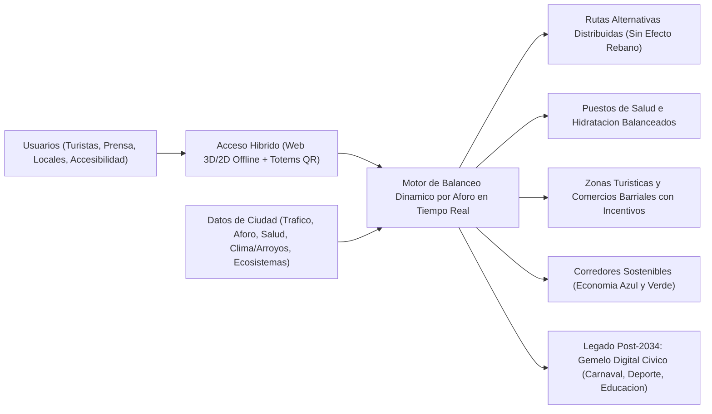

---
tags:
  - quijam-2026
  - barranquilla-2034
  - mundial-2034
  - propuesta
  - smart-city
---

# Quilla3D 2034 — Propuesta para Barranquilla Sede del Mundial 2034

> **Nota base de lluvia de ideas:** [[Barranquilla 2034 sede mundial.]]
>
> **Opciones de nombre:** **Quilla3D 2034** *(principal)* · *Barranquilla Viva 3D* · *QuillaFlow 2034* · *Atlas Quilla 2034*
>
> **Idea fuerza:** *"Toda la ciudad en juego: un mapa 3D inteligente que descentraliza el Mundial 2034 por toda Barranquilla, garantiza inclusión y salud en tiempo real, protege la economía azul y verde, y deja un gemelo digital permanente para la ciudad."*

---

## 1. Identificación del Problema

Ser sede del Mundial 2034 implica recibir simultáneamente a decenas de miles de turistas, hinchas y periodistas en una ciudad con dinámicas urbanas, climáticas y sociales específicas. El problema central no es solo la falta de capacidad en un punto, sino la **concentración extrema de personas en los mismos lugares al mismo tiempo** (especialmente alrededor del Estadio Metropolitano Roberto Meléndez y los corredores turísticos y hoteleros tradicionales).

Las plataformas de navegación convencionales (como Google Maps o Waze) agravan este fenómeno por el **"efecto rebaño"**: cuando una vía se congestiona, redirigen a todos los usuarios hacia la misma ruta alterna, trasladando el colapso de un punto a otro. A partir de esta raíz se desprenden cinco problemas críticos:

1. **Colapso por concentración de flujos masivos (turistas, periodistas y locales):** Aglomeraciones en accesos al estadio, retrasos críticos para prensa acreditada y visitantes, saturación de puestos de atención y congestión vial que paraliza la vida cotidiana de los barranquilleros.
2. **Brechas en infraestructura física, digital y tecnológica:** Riesgo de saturación o caída de redes móviles alrededor del estadio y eventos masivos, exclusión de usuarios sin datos locales o con teléfonos de gama baja, y desconexión entre movilidad, espacios públicos y escenarios deportivos.
3. **Impacto ambiental y vulnerabilidad climática local:** Incremento de emisiones por trancones, exposición a calor extremo del Caribe, riesgos por arroyos en temporada de lluvias y presión turística no regulada sobre ecosistemas estratégicos de **economía azul y verde** (Río Magdalena, Gran Malecón y Ciénaga de Mallorquín).
4. **Exclusión física, lingüística y económica:** Barreras de acceso para personas con movilidad reducida, baja visión o adultos mayores; brechas de idioma para visitantes extranjeros; y concentración del derrame económico del Mundial en pocos sectores, dejando por fuera a barrios, comercios y emprendedores locales.
5. **Vacío post-evento ("el día después"):** Riesgo de que la tecnología creada para el torneo se apague al finalizar el Mundial y de que los escenarios deportivos y espacios públicos pierdan uso comunitario (*"elefantes blancos"*), sin apropiación ciudadana ni impacto educativo duradero.

---

## 2. Población Objetivo y Ecosistema de Actores

La propuesta adopta un enfoque de **ecosistema multi-actor con inclusión universal**, diseñado tanto para quienes visitan la ciudad como para quienes la habitan antes, durante y después de 2034.

| Categoría | Segmento de Población | Necesidad Principal | Cómo los atiende Quilla3D 2034 |
| :--- | :--- | :--- | :--- |
| **Usuarios Directos** | **Turistas e hinchas** (nacionales e internacionales) | Orientarse en el estadio y la ciudad de forma segura, rápida, en su idioma y sin quedar atrapados en aglomeraciones. | Mapa 3D interactivo multi-idioma (estadio + ciudad), rutas alternativas balanceadas, puestos de salud/hidratación y descubrimiento de zonas menos saturadas. |
| **Usuarios Directos** | **Periodistas y prensa acreditada** | Puntualidad estricta entre hoteles, zonas mixtas, estadio y puntos de cobertura sin quedar bloqueados por el tráfico masivo. | Perfiles y corredores prioritarios diferenciados con tiempos reales de traslado y rutas alternas dedicadas. |
| **Usuarios Directos** | **Ciudadanía barranquillera (inclusión universal)** | Seguir moviéndose por la ciudad durante el torneo y disfrutar del evento sin barreras físicas, sensoriales ni digitales. | Rutas 100% accesibles (rampas, sin barreras, zonas sombreadas), guía por voz y alto contraste, modo web liviano/offline y tótems físicos 3D gratuitos. |
| **Aliados / Beneficiarios** | **Comercios, restaurantes y emprendedores barriales** | Recibir parte del flujo turístico y económico que normalmente se concentra solo en hoteles del norte y el estadio. | Visibilidad dentro del mapa 3D y sistema de micro-incentivos que redirige visitantes hacia zonas y negocios locales menos congestionados. |
| **Aliados / Beneficiarios** | **Alcaldía, Secretarías (Movilidad, Salud, Ambiente) y organismos de socorro** | Visibilidad en tiempo real para prevenir colapsos, balancear emergencias médicas y proteger ecosistemas y espacio público. | Panel de mando con mapas de calor, aforos en vivo, balanceo de puestos de salud y alertas climáticas (calor/arroyos). |
| **Legado Post-2034** | **Colegios, universidades y comunidades deportivas barriales** | Aprovechar la inversión tecnológica y deportiva para educación, cultura ciudadana y recreación después del Mundial. | Gemelo digital público con datos abiertos, recorridos educativos 3D y activación/uso comunitario de espacios deportivos y parques. |

---

## 3. Objetivos

### Objetivo General
Diseñar e implementar **Quilla3D 2034**, una plataforma de mapeo 3D interactivo a escala Ciudad-Estadio para Barranquilla que descentralice y balancee dinámicamente los flujos de visitantes, prensa y ciudadanos, garantice acceso inclusivo a salud, movilidad sostenible y economía azul/verde, y evolucione tras el Mundial hacia un gemelo digital ciudadano permanente.

### Objetivos Específicos
1. **Descentralizar los flujos urbanos y del estadio:** Implementar un motor de balanceo dinámico por capacidad/aforo en tiempo real combinado con incentivos locales para evitar la concentración masiva en una sola vía o zona y activar comercial y turísticamente toda la ciudad.
2. **Garantizar atención oportuna en salud y prevención climática:** Integrar en el mapa 3D la ubicación y disponibilidad de puestos de salud, puntos de hidratación/sombra y alertas en tiempo real de calor extremo y arroyos.
3. **Asegurar inclusión universal y resiliencia tecnológica:** Proveer perfiles accesibles (movilidad reducida, multi-idioma, guía por voz/alto contraste) junto con una arquitectura híbrida **web ligera + offline-first + tótems físicos 3D con QR y Wi-Fi público** que opere incluso si falla la red celular o el usuario no tiene smartphone de gama alta.
4. **Minimizar el impacto ambiental y potenciar la economía azul y verde:** Priorizar rutas de movilidad baja en emisiones (caminata sombreada, transporte público/eléctrico y bicicleta) y regular el aforo turístico en activos ecológicos clave (Río Magdalena, Gran Malecón y Ciénaga de Mallorquín) para promover ecoturismo sin degradar los ecosistemas.
5. **Asegurar la apropiación y el legado post-2034:** Transformar la plataforma al cierre del Mundial en un gemelo digital permanente de Barranquilla para gestionar grandes eventos (Carnaval, conciertos, partidos), emergencias, uso comunitario de escenarios deportivos y educación ciudadana/universitaria mediante datos abiertos.

---

## 4. Planteamiento de la Solución

**Quilla3D 2034** es una plataforma interactiva de **mapeo 3D a escala Ciudad-Estadio** (Estadio Metropolitano Roberto Meléndez + toda la ciudad de Barranquilla) que convierte a toda la ciudad en un sistema coordinado de recepción, movilidad, salud, sostenibilidad y legado.

### Componentes Clave de la Solución

#### 1. Mapa 3D Interactivo Ciudad-Estadio
* **Vista Estadio Metropolitano 3D:** Visualización detallada de puertas, tribunas, rutas de entrada/salida, zonas de prensa, áreas accesibles y puestos de salud internos y perimetrales.
* **Vista Toda Barranquilla 3D:** Integración de corredores urbanos, aeropuerto, hoteles, Transmetro, espacios públicos, escenarios deportivos, circuitos culturales y activos naturales (Río Magdalena, Gran Malecón, Ciénaga de Mallorquín) para **usar toda la ciudad** y evitar que todos converjan al mismo punto simultáneamente.

#### 2. Balanceo Dinámico de Flujos + Incentivos Locales (Antídoto al "Efecto Waze")
* En vez de entregar la misma ruta alterna a todos los usuarios, el motor asigna rutas por **cupos de capacidad en tiempo real** según densidad peatonal, congestión vehicular y perfil del usuario.
* Para que la ciudadanía y los turistas realmente elijan zonas desconcentradas, la plataforma muestra **tiempos de espera en vivo** y activa **micro-incentivos locales** (experiencias culturales, descuentos o beneficios en restaurantes, comercios y rutas gastronómicas de barrios menos saturados), repartiendo el flujo y la derrama económica en toda Barranquilla.

#### 3. Red 3D de Salud, Seguridad y Prevención Climática
* Enrutamiento inmediato hacia **puestos de salud disponibles**, balanceando también su demanda para evitar saturar un único punto de atención.
* Mapa en tiempo real de **puntos de hidratación, zonas de sombra y alertas climáticas** ante calor extremo o presencia de arroyos en temporada de lluvias.

#### 4. Inclusión Universal y Acceso Híbrido Resiliente
* **Inclusión en la experiencia:** Rutas 100% accesibles sin barreras físicas para personas con movilidad reducida y adultos mayores, interfaz multi-idioma, lectura fácil, alto contraste y guía por voz para personas con baja visión.
* **Inclusión y resiliencia digital:**
  * Funciona como **web app ligera** sin obligar a descargar aplicaciones pesadas.
  * Incluye **degradación automática a vista 2D liviana** para celulares de gama baja y **caché offline-first** de mapas, rutas y puestos de salud para resistir caídas de red celular cerca del estadio.
  * Se complementa con **tótems físicos 3D interactivos con códigos QR y Wi-Fi público** ubicados en aeropuerto, estadio, estaciones de Transmetro, parques y Fan Zones.

#### 5. Capa Ambiental y de Economía Azul y Verde
* Prioriza movilidad de bajas emisiones (rutas peatonales sombreadas, transporte público/eléctrico, ciclorrutas) y ubica puntos de reciclaje y gestión de residuos.
* Regula y distribuye el aforo en corredores de **economía azul y verde** (Río Magdalena, Gran Malecón y Ciénaga de Mallorquín), impulsando el ecoturismo regenerativo sin sobrepasar la capacidad de carga de los ecosistemas.

#### 6. Legado Post-2034: Gemelo Digital Ciudadano Permanente
Al finalizar el Mundial 2034, la plataforma no se desecha; queda instalada como infraestructura digital pública para Barranquilla en cuatro frentes:
* **Grandes eventos y turismo:** Gestión de flujos y seguridad para el Carnaval de Barranquilla, conciertos, ferias y partidos locales/internacionales.
* **Activación de espacios deportivos:** Visibilización y gestión comunitaria de canchas, parques y escenarios renovados para evitar *"elefantes blancos"*.
* **Educación y cultura ciudadana:** Recorridos 3D pedagógicos y **datos abiertos** para colegios, SENA y universidades en urbanismo, tecnología, inclusión y sostenibilidad.
* **Gestión urbana y de riesgo:** Herramienta permanente para la Alcaldía en planeación de movilidad, red de salud y alerta temprana de arroyos.

---

## 5. Propuesta de Valor

### Declaración Central
> **Quilla3D 2034** transforma a toda Barranquilla en un ecosistema inteligente e inclusivo que, mediante un mapa 3D con balanceo dinámico de flujos, evita el colapso urbano durante el Mundial 2034, reparte el turismo y el beneficio económico por toda la ciudad cuidando su entorno azul y verde, y deja como legado permanente un gemelo digital cívico, deportivo y educativo.

### Valor Entregado por Actor
* **Para turistas, hinchas y prensa:** Experiencia sin estrés, segura, en su idioma y accesible; menos filas y trancones, acceso inmediato a salud e hidratación, y descubrimiento auténtico de toda Barranquilla (no solo el estadio).
* **Para ciudadanos y barrios locales:** Menos caos vial en su día a día, inclusión real sin brecha digital, nuevos ingresos para comercios barriales y una ciudad que conserva mejores espacios públicos y deportivos después del torneo.
* **Para la Alcaldía y el territorio:** Control preventivo en tiempo real de movilidad, salud y aforos ecológicos; protección de la Ciénaga de Mallorquín y el Río Magdalena; e inversión tecnológica que se amortiza a largo plazo al quedar activa para el Carnaval, emergencias y educación.

### ¿Qué la diferencia de soluciones convencionales?

| Criterio | Apps de mapas tradicionales (Google Maps / Waze) | Apps típicas de un Mundial | **Quilla3D 2034** |
| :--- | :--- | :--- | :--- |
| **Gestión de rutas alternas** | Envía a todos por la misma alterna ("efecto rebaño"). | Solo muestra mapas estáticos de sedes. | **Balanceo dinámico por capacidad en tiempo real** para no saturar un solo lugar. |
| **Uso de la ciudad** | Se limita a ir del punto A al B. | Concentra a todos en Estadio y Fan Fest. | **Activa y distribuye el flujo en toda Barranquilla** con incentivos hacia comercios locales. |
| **Inclusión y caída de red** | Depende de internet constante y celular moderno. | Requiere descarga obligatoria y alta conectividad. | **Web ligera + offline-first + tótems físicos 3D + accesibilidad universal**. |
| **Clima y economía azul/verde** | Sin foco ecológico ni alertas locales de arroyos/aforo. | No integra protección ambiental local. | **Rutas sombreadas, alertas de calor/arroyos y control de aforo** en Río/Ciénaga. |
| **Después del Mundial** | Sin apropiación municipal ni educativa. | Se descontinúa al terminar el evento. | **Legado permanente:** Carnaval, deporte barrial, emergencias y educación. |

---

## 6. Guion Rápido de Pitch (60 segundos) y Defensa ante Jurado

### Pitch en 60 segundos
> *"El mayor riesgo de llevar el Mundial 2034 a Barranquilla no es solo recibir a miles de turistas y periodistas: es concentrarlos a todos en el mismo lugar al mismo tiempo, colapsando vías, puestos de salud y dejando por fuera a la mayoría de la ciudad. Por eso creamos **Quilla3D 2034**, un mapa 3D interactivo del Estadio Metropolitano y de toda Barranquilla que usa balanceo dinámico por aforo en tiempo real para asignar rutas alternativas distintas —sin mandar a todo el mundo por el mismo corredor— y que motiva a los visitantes a descubrir barrios, comercios locales y corredores de economía azul y verde como el Gran Malecón y la Ciénaga de Mallorquín sin saturarlos. Incluye puestos de salud balanceados, alertas de calor y arroyos, rutas 100% accesibles, modo offline y tótems físicos 3D para que nadie quede excluido si falla el internet. Y lo más importante: cuando termine el Mundial, Quilla3D no se apaga; queda como el gemelo digital ciudadano de Barranquilla para el Carnaval, la activación de escenarios deportivos y la educación en colegios y universidades."*

### Respuestas rápidas a preguntas difíciles del jurado
* **¿Qué pasa si se cae el internet cerca del Estadio Metropolitano?**
  La web app guarda en caché *offline-first* el mapa liviano (con degradación a 2D para gama baja), rutas asignadas y puestos de salud, y se apoya en tótems físicos 3D con Wi-Fi público y QR en nodos estratégicos.
* **¿Por qué un turista aceptaría ir a otra zona menos congestionada?**
  Porque ve tiempos de espera reales en 3D y recibe micro-incentivos en experiencias culturales, gastronomía y comercios locales de esos barrios, ahorrando tiempo y descubriendo la ciudad auténtica.
* **¿Cómo garantizan que no quede en un gasto temporal solo para un mes de torneo?**
  Desde su arquitectura nace como infraestructura digital pública reutilizable para el Carnaval de Barranquilla, emergencias climáticas (arroyos), gestión comunitaria de escenarios deportivos y plataforma de datos abiertos educativos.
