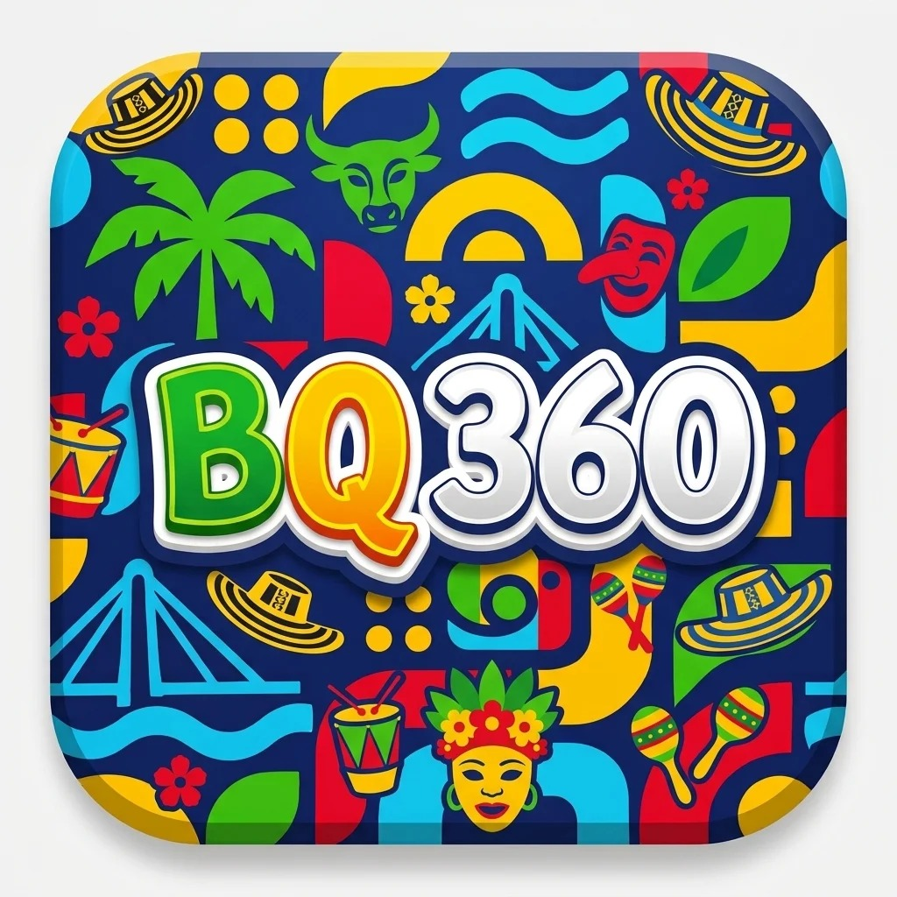
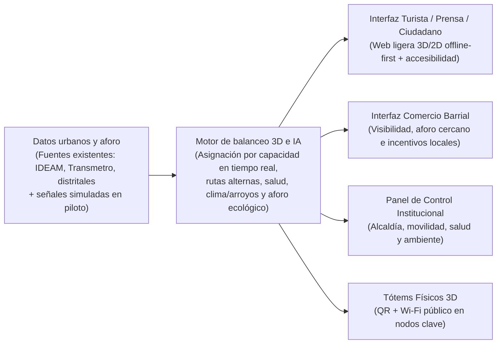

---
tags:
  - quijam-2026
  - sprint-1
  - bq360
  - barranquilla-2034
fecha: 2026-11-26
proyecto: BQ360
estado: Cierre Sprint 1
---

# Cierre Sprint 1 — BQ360 (Barranquilla 2034)



> **Documentos relacionados:** [[BQ360]] · [[BQ360_Sprint1_Dossier]] · [[Propuesta Barranquilla 2034 - BQ360]] · [[Barranquilla 2034 sede mundial.]]
>
> **Objetivo del documento:** Consolidar el enfoque unificado de **BQ360**, los ajustes obligatorios de rigor, la estructura del entregable (póster/presentación) y el plan de investigación en campo para cerrar el **Sprint 1** en QUIJAM.

---

## 1. Enfoque unificado: BQ360

El proyecto integra bajo una sola identidad (**BQ360**) dos capas complementarias:

| Componente | Qué aporta a BQ360 | Peso estratégico en QUIJAM |
| :--- | :--- | :--- |
| **Capa estratégica territorial (BQ360)** | Estructura de **programa estratégico territorial** (evita verse como una app aislada), foco en la fragmentación urbana entre cuatro actores, caso demostrativo de un partido en el Estadio Metropolitano y plan de validación en campo. | Responde a **Visión estratégica e integralidad (20 %)** + **Integración de las cinco dimensiones (15 %)** = **35 % de la rúbrica**. |
| **Capa operativa 3D y resiliencia (BQ360)** | Diferenciador frente a Google Maps/Waze: **balanceo dinámico por capacidad en tiempo real** para evitar el *"efecto rebaño"*, mapa 3D Ciudad-Estadio, resiliencia **offline-first** con degradación a 2D y **tótems físicos con QR/Wi-Fi**, atención a **prensa acreditada**, alertas de **calor y arroyos**, y protección de la **economía azul y verde** (Río Magdalena, Gran Malecón y Ciénaga de Mallorquín). | Diferenciación técnica, pertinencia local en Barranquilla e inclusión real ante fallas de conectividad. |
| **Legado post-2034** | La plataforma no se apaga tras el Mundial: queda instalada como **gemelo digital ciudadano permanente** para el Carnaval de Barranquilla, la activación comunitaria de escenarios deportivos, la gestión de emergencias y la educación con datos abiertos. | Sostenibilidad institucional y apropiación ciudadana a largo plazo. |

---

## 2. Ajustes obligatorios para encajar con el Sprint 1

### 2.1 Corrección de cifras base (fuente oficial obligatoria)
Se descartan las cifras sin verificación presentes en [[BQ360]] (`1.248.000 habitantes` y `PIB de $46,8 billones`) y se adoptan los datos oficiales de la presentación del bootcamp:

| Indicador | Dato oficial adoptado | Fuente y año | Reemplaza dato anterior |
| :--- | :--- | :--- | :--- |
| **Población de Barranquilla** | **1.334.509 habitantes** | DANE (2024) | ~~1.248.000 habitantes~~ |
| **PIB distrital** | **$40,7 billones COP** (**79 %** sector servicios) | MinHacienda (2023) | ~~$46,8 billones~~ |
| **Extensión territorial** | **154 km²** | Presentación oficial bootcamp | *(No registrado)* |

> **Regla de rigor para todo el equipo:** Cada dato nuevo que entre al póster o a la presentación debe indicar explícitamente **fuente, año y alcance**.

### 2.2 Uso exacto de las cinco dimensiones oficiales
Todas las iniciativas deben mapearse literalmente bajo las cinco dimensiones oficiales de QUIJAM:
1. **Ciudad y territorio**
2. **Sostenibilidad**
3. **Ciudad inteligente**
4. **Ciudadanía**
5. **Economía y oportunidades**

### 2.3 Delimitación de un escenario piloto concreto
En lugar de presentar genéricamente *"toda Barranquilla"* en abstracto, el diagnóstico y la demostración se enfocan en un **corredor piloto medible** y luego muestran cómo escala al resto de la ciudad:

```text
Estadio Metropolitano Roberto Meléndez
        ↕
Transmetro y comercios barriales (corredor intermedio)
        ↕
Gran Malecón del Río / Ecoparque Ciénaga de Mallorquín
```

### 2.4 Incorporación de dos lecciones críticas de ciudades sede
1. **Realismo presupuestal:** Los megaeventos deportivos superan su presupuesto inicial en promedio un **172 %**. La arquitectura debe priorizar infraestructura modular, reutilización de activos existentes y control de costos.
2. **Cumplimiento a tiempo:** Incorporar explícitamente la lección de los **Juegos Panamericanos 2027 en Barranquilla** (gobernanza clara, hitos verificables y compromisos ejecutables por fases).
3. **Transparencia sobre datos:** Diferenciar desde el Sprint 1 qué fuentes de datos existen hoy y cuáles serán simuladas durante el prototipo.

### 2.5 Respeto estricto al alcance del Sprint 1
* **Dentro del Sprint 1 (hoy):** Diagnóstico con separación de síntomas y causas raíz, mapa de actores, problema central, propuesta de valor, arquitectura inicial y mapa de las 5 dimensiones oficiales.
* **Diferido al Sprint 2 (fuera de alcance hoy):** Desarrollo técnico de código, definición final de stack tecnológico e implementación de los 9 módulos.

---

## 3. Estructura definida para el entregable del Sprint 1

El póster o presentación de cierre del Sprint 1 debe organizarse en **seis bloques concretos**:

### Bloque 1 — Problema central y diagnóstico
* Cifras oficiales verificadas de Barranquilla (DANE 2024, MinHacienda 2023, 154 km²) aplicadas al corredor piloto.
* Separación explícita entre **síntomas visibles** (trancones, filas, saturación de salud, quejas de visitantes y vecinos) y **causas raíz**:
  * Fragmentación urbana e institucional entre servicios y actores.
  * Concentración masiva y *"efecto rebaño"* de navegadores convencionales.
  * Brecha digital, saturación de redes móviles y barreras de accesibilidad física/idiomática.
  * Presión climática (calor extremo, arroyos) y vulnerabilidad de ecosistemas estratégicos.

### Bloque 2 — Propuesta de valor
* **Mapa 3D Ciudad-Estadio** enfocado en el corredor piloto y escalable a toda Barranquilla.
* **Balanceo dinámico por aforo en tiempo real** que reparte rutas, puestos de salud y destinos para no enviar a todos al mismo punto.
* **Acceso inclusivo y resiliente:** web ligera *offline-first* (con degradación a 2D para equipos básicos), accesibilidad universal (movilidad reducida, idioma, voz/alto contraste) y **tótems físicos 3D** con QR y Wi-Fi público.

### Bloque 3 — Mapa de actores y beneficiarios
* **Turistas e hinchas + prensa acreditada:** Orientación segura, corredores prioritarios para prensa, salud e hidratación.
* **Ciudadanía barranquillera:** Movilidad cotidiana protegida, inclusión sin barreras físicas ni digitales y disfrute de espacios públicos.
* **Comercios y emprendedores barriales:** Visibilidad y flujo desconcentrado mediante incentivos en zonas menos saturadas.
* **Autoridades y entidades reales:** Alcaldía, Secretarías (Movilidad, Salud, Ambiente), Barranquilla Verde, Transmetro, Cámara de Comercio, universidades y SENA.

### Bloque 4 — Las cinco dimensiones oficiales y su conexión

| Dimensión oficial | Iniciativa concreta en BQ360 | Conexión con las demás dimensiones |
| :--- | :--- | :--- |
| **Ciudad y territorio** | Corredor piloto 3D (Metropolitano ↔ Transmetro/barrios ↔ Malecón/Mallorquín) con rutas accesibles y activación de escenarios deportivos. | Conecta infraestructura física y transporte con los flujos digitales de *Ciudad inteligente* y el comercio de *Economía y oportunidades*. |
| **Sostenibilidad** | Rutas peatonales sombreadas y transporte limpio, alertas de calor y arroyos, control de aforo ecológico en Río Magdalena y Ciénaga de Mallorquín, y gestión de residuos. | Protege el territorio de *Ciudad y territorio* y guía las recomendaciones del motor de *Ciudad inteligente*. |
| **Ciudad inteligente** | Motor de balanceo dinámico por aforo en tiempo real, mapa 3D/2D *offline-first*, tótems físicos con QR/Wi-Fi y transparencia entre datos existentes y simulados. | Articula alertas para *Ciudadanía*, desvíos de demanda hacia *Economía y oportunidades* y control ambiental en *Sostenibilidad*. |
| **Ciudadanía** | Accesibilidad universal, soporte multi-idioma, red balanceada de puestos de salud e hidratación, validación con vecinos y educación ciudadana con datos abiertos. | Garantiza que *Ciudad inteligente* no excluya por brecha digital y sostiene el uso comunitario en *Ciudad y territorio*. |
| **Economía y oportunidades** | Desconcentración del gasto turístico hacia comercios barriales e economía popular mediante incentivos en rutas menos saturadas, reduciendo barreras de idioma, visibilidad y pagos. | Convierte el balanceo de *Ciudad inteligente* en incentivo real para *Ciudadanía* y visitantes, fortaleciendo la economía de servicios local (79 % del PIB). |

### Bloque 5 — Arquitectura inicial



### Bloque 6 — Legado post-2034
* **Carnaval y grandes eventos:** Reutilización directa del balanceo de multitudes, puestos de salud y rutas alternas.
* **Escenarios deportivos activos:** Visibilidad y gestión comunitaria para evitar el subuso o abandono post-evento.
* **Emergencias climáticas:** Alerta temprana y rutas seguras frente a arroyos y olas de calor.
* **Educación y datos abiertos:** Insumo permanente para colegios, SENA y universidades en planeación urbana, tecnología y cultura ambiental.

---

## 4. Plan de investigación priorizado (6 frentes)

Checklist operativo para ejecutar hoy y respaldar el póster del Sprint 1 con evidencia verificada:

### 4.1 Territorio y movilidad
- [ ] Confirmar cifras oficiales DANE (1.334.509 hab., 2024), PIB distrital MinHacienda ($40,7 billones, 2023; 79 % servicios) y área (154 km²).
- [ ] Verificar capacidad oficial actual y proyectada del Estadio Metropolitano Roberto Meléndez.
- [ ] Identificar las vías exactas que colapsan en días de partido alrededor del Metropolitano.
- [ ] Mapear cobertura, estaciones y capacidad de **Transmetro** en el corredor piloto.
- [ ] Documentar conectividad y tiempos actuales desde el **Aeropuerto Internacional Ernesto Cortissoz**.
- [ ] Revisar estado actual de accesibilidad física (andenes, rampas, cruces) en el corredor piloto.

### 4.2 Clima y sostenibilidad
- [ ] Recopilar datos oficiales de temperatura y sensación térmica típica en Barranquilla (especialmente horarios de partido).
- [ ] Identificar arroyos críticos activos o históricos en vías de acceso al estadio y al corredor piloto.
- [ ] Evaluar presión ambiental y límites de capacidad en el **Gran Malecón**, **Río Magdalena**, **Ciénaga de Mallorquín** y playas cercanas.
- [ ] Investigar manejo actual de residuos sólidos en eventos masivos (partidos y Carnaval).

### 4.3 Conectividad y datos
- [ ] Documentar reportes o evidencia de saturación de red móvil cerca del Estadio Metropolitano en eventos masivos.
- [ ] Verificar cobertura y estado actual de zonas de Wi-Fi público en Barranquilla.
- [ ] Inventariar fuentes de datos abiertas ya existentes (IDEAM, cámaras, portales de datos distritales/nacionales) para separar qué es **real hoy** vs. **simulado en el MVP**.
- [ ] Revisar 2–3 referentes reales de gemelos digitales urbanos y control de aforos en grandes eventos.

### 4.4 Inclusión y validación en campo (HOY)
- [ ] Consultar cifras oficiales de población con discapacidad o movilidad reducida en Barranquilla.
- [ ] Recopilar quejas más frecuentes de asistentes y vecinos en partidos y eventos masivos.
- [ ] **Ejecutar 3 a 5 entrevistas cortas hoy** con:
  - [ ] Comerciantes locales del entorno / barrios.
  - [ ] Asistentes frecuentes a partidos en el Metropolitano.
  - [ ] Ciudadanos residentes afectados por cierres viales y aglomeraciones.

### 4.5 Economía popular
- [ ] Consultar tasa oficial más reciente de informalidad laboral en Barranquilla y área metropolitana (DANE).
- [ ] Caracterizar pequeños comercios barriales dentro del corredor piloto.
- [ ] Documentar evidencia de concentración del gasto turístico en zonas tradicionales frente a barrios populares.
- [ ] Identificar barreras prácticas de los comerciantes (idioma, medios de pago digitales, visibilidad en mapas).

### 4.6 Gobernanza y legado
- [ ] Mapear rol concreto de las entidades reales que sostendrían el programa: **Alcaldía de Barranquilla**, **Secretarías (Movilidad, Salud, Ambiente, Educación)**, **Barranquilla Verde**, **Transmetro**, **Cámara de Comercio de Barranquilla**, **universidades locales** y **SENA**.
- [ ] Revisar el estado actual de uso y mantenimiento de los escenarios construidos/renovados para los **Juegos Centroamericanos y del Caribe Barranquilla 2018**.
- [ ] Documentar brevemente el caso de los **Juegos Panamericanos 2027** y el referente del **172 %** de sobrecosto promedio en megaeventos como sustento de gobernanza y realismo presupuestal.
